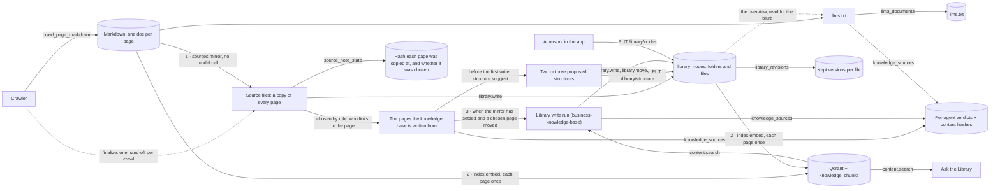
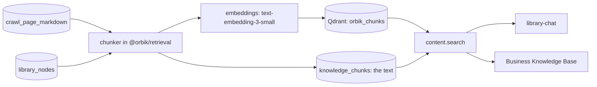

# The Library

The Library is a workspace's knowledge as a filesystem: folders and files, per workspace, that
agents and people both read and write. It is the harness the rest of Orbik is meant to work from —
a sales agent drafting outreach, an ads agent writing copy, an SEO agent recommending content, and
the user's own Claude, all briefed from the same place.

It has two layers. The **source layer** under `/sources` is a mirror: a copy of every crawled
page, word for word, at a path derived from the URL, written by code with no model call. The
**subject tree** above it — an overview, an index, and subjects such as `services` and
`customers` filed into a few top-level folders the person chose (`00 Start Here`, `02 Offer`, …) —
is judgement: what the company *is*, written by a model from the pages chosen for it and linking
down into their copies. One home per fact, twice over: the source file is the home of what a page says, the
subject file is the home of what it means.

Three agents touch it. The **Library agent** builds and maintains all of it, in three stages that
nobody starts by hand: it **mirrors** every page the crawler brings back into the source layer
and chooses which of them the knowledge base is written from (`sources.mirror`), **embeds** what
changed (`index.embed`, the retrieval index), and **writes** the subject tree from the chosen
pages (a run of the `business-knowledge-base` definition) into the top-level folders a person chose
from two or three a model proposed (`structure.suggest`). The crawler calls it when a crawl
finishes, and each stage follows from the one before — see
[The Library agent](#the-library-agent). The **llms.txt** agent reads the overview and publishes a
short curated map of the site. **Ask**, the chat in the side panel of every workspace page,
answers a question from the retrieval index over the site's pages and the Library's files, citing
every claim — and saves to the Library or rearranges it when the person tells it to, recorded as
the person's writes "via Ask".



Why a tree rather than a flat set of pages: one level deep with slugs the model chose, nothing is
addressable by meaning, there is no search, and a consuming agent has to list everything and guess
from titles. The Library is a tree with folder summaries, a maintained
entry map, and a search index — so an agent that has never seen a workspace can find its way in.

## The shape

One Library per workspace. The root is implicit and named after the workspace. Its top level is a
few folders the **person** chose when the Library was first built — numbered by default,
`00 Start Here`, `01 Company`, `02 Offer` — and two that code writes. Beneath the chosen
folders, subjects are filed under the standard names (`services`, `pricing`, `case-studies`) to a
bounded depth; which subjects a site has is the agent's judgement, never a template. See
[The top level: a structure the person chose](#the-top-level-a-structure-the-person-chose).

```
Acme
├── 00-start-here/            "00 Start Here" (role: start)
│   ├── overview              (role: overview — the briefing everything starts from)
│   ├── index                 (role: index — what to read for which job)
│   └── open-questions
├── 01-company/               "01 Company"
│   └── about
├── 02-offer/                 "02 Offer"
│   ├── services/
│   │   ├── development
│   │   └── ai
│   └── pricing
├── 03-proof/                 "03 Proof"
│   ├── case-studies/         (names a listing: shows the case-study pages beneath it)
│   │   └── summary
│   └── customers
├── brand/                    (fixed: the Design system agent's)
└── sources/                  (fixed: the mirror, kept in step by code)
    └── website/
        ├── home
        ├── blog/
        │   └── case-study-northwind
        └── services/
            └── ai/
                └── chatbots
```

The paths follow the titles (`02 Offer` is `/02-offer`), and a person sees the same folders an
agent addresses: there is no second grouping for display.

Two files are found by **role**, because a consumer arriving at a Library it has never seen has to
be able to start reading without being told the folder names first — and because they live in the
first chosen folder, which a person may rename, they are not at fixed paths:

- **The overview** (`role: "overview"`) — the front page. Cannot be deleted; agents never move it.
- **The index** (`role: "index"`) — the entry map, in the style of an Obsidian map of content:
  "for sales outreach read these; for ads these; for SEO these", plus a line per folder. Cannot be
  deleted.

The tree root names both, as `overviewPath` and `indexPath`, and every reader asks there
(`store.roles`). Until a file carries a role, its path is `<start folder>/overview`, the start
folder being the one with `role: "start"`; a Library built before roles, with no start folder,
keeps them at `/overview` and `/index` until it is rebuilt. `library.read` of `/overview` or
`/index`, where nothing is stored at that path, opens the file that carries the role — readers
asked for those names for long enough — and the answer names the real path. That is the role, not
an alias of an old path: a renamed folder's old path resolves to nothing.

Three top-level folders are fixed in path and title, carry no number, and are shown after the
chosen folders by a fixed rank (`compareLibrarySiblings`), because they are not judgement at all:

- **`/sources`** — the source layer. Every agent but the mirror is refused a write inside it.
- **`/sources/website`** — the crawl's branch of it. One site per workspace today, so there is no
  host segment; the path is built so `/sources/website/<host>/…` can be switched on if a workspace
  ever crawls two domains. A Notion connector would fill `/sources/notion/…` beside it, which is
  the whole reason the origin is in the path rather than `/website` and `/notion` sitting at the
  root among the subject folders.
- **`/brand`** — reserved and, since v3 of the Design system agent, empty. It held a copy of the
  design system (`/brand/design-system`); the Brand page and `brand_get` are where the system is
  read now, and the worker removed the copies at its first start after the change
  (`agents/src/library/retireBrandGuides.js`). The store's rules for it are unchanged: every agent
  but the Design system agent is refused a write inside it, and the folder cannot be moved,
  renamed or deleted. See [design-system.md](design-system.md).

Paths are lowercase words and digits joined by hyphens, materialised on each node. A number at the
front of a top-level folder's title is a naming convention Orbik suggests, never a mechanism:
nothing reads it. Ordering is an explicit `order` field a person sets in the app, and agents never
set it; the default is folders first, then by display name with numbers compared as numbers, which
is what puts `00` before `01` before `10`.

Conventions the instructions make non-negotiable, and the tools check where marked:

- **Knowledge, not work product.** Campaign drafts, ad copy and audit reports are outputs of runs
  and live outside the Library, linking to it. (Enforced by which agents get write tools.)
- **One home per fact.** One file per entity; other files link to it as `[[/03-proof/customers/acme]]` rather
  than restating it. An agent's link that resolves to nothing is refused (`UNRESOLVED_LINK`); a
  person's is reported and saved anyway, because a person writing a link before the file is
  drafting and losing their work to a rule about tidiness would be worse.
- **Meaning here, data elsewhere.** Rankings, search performance and ad metrics belong in their
  own collections; a Library file says what they mean and where they live.
- **Claims as claims.** What the website says is reported as what the site says. What a person
  writes is ground truth, and every file records which kinds of source it draws on so a consumer
  can tell the two apart.

## Two writers, one set of rules

Files have no owner. The rules are about **what must survive a write**, not who may write, and
they live in one place — `@orbik/library` (`packages/library/src/`) — used by the agent tools
and by the API validators alike. A person saving a file and an agent writing one obey the same
rules about paths, depth, size, locks and provenance, because there is one implementation of them.

- **Protected blocks.** When a person saves a file, every Markdown block that differs from the
  version the agent last wrote is recorded as theirs, by hash and text, and — for a block claimed
  since workspaces had members — by `userId`, the person whose save claimed it. A block keeps its
  author through later saves by others and through links a rename rewrites. Changing it makes it a
  new block, claimed by whoever changed it, and so does deleting it and bringing it back: one put
  back by a restore or a paste is claimed by whoever put it back. A block recorded with no `userId`
  predates members and is the workspace owner's, who was the only person able to write it. A
  block is a paragraph,
  list, table or heading separated by blank lines, compared after whitespace normalisation, with
  fenced code kept whole. Editing one word of an agent paragraph claims the whole paragraph —
  deliberately coarse, because a finer rule would let an agent rewrite half of somebody's
  paragraph and still pass the check.
- **Reads show the boundary.** `library.read` returns the Markdown with the person's blocks wrapped
  in `<!-- user -->` … `<!-- /user -->` so the agent can see what it must keep. The markers are
  accepted back and stripped on write. The API's read returns the same blocks as a list beside an
  unmarked document instead, because markers in a textarea would be an editing hazard — with
  `userBlockAuthors` beside `userBlocks`, `{userId, email}` for each block in the same order (null
  for an account that no longer exists), and a person's last change says who (`updatedBy.userId`
  and `updatedBy.email`), as each person's version in the file's history does.
- **Writes are checked.** `library.write` from an agent refuses a version that drops a protected
  block (`PROTECTED_CONTENT_MISSING`), naming the text so the agent can restore it and retry inside
  the same turn. The agent may reorder, add before and after, and rewrite its own paragraphs
  freely.
- **Deletions are respected.** A block a person removed is recorded by hash; an agent write that
  reintroduces it is refused (`REMOVED_CONTENT_REINTRODUCED`).
- **Lock is an opt-out.** A person can lock a file or a folder; agents never write inside a locked
  node, or anything under it, and neither does a person's own AI writing for them over MCP (below).
  Default is open. Only a person at the keyboard locks or unlocks.
- **Folders.** Agents file into existing folders first and create one only when none fits. They
  never rename, move or delete a folder a person created (`USER_FOLDER_PROTECTED`), and may delete
  only empty folders (`FOLDER_NOT_EMPTY`).
- **The top level is the person's.** Every agent but the mirror (`/sources`) and the Design system
  agent (`/brand`) is refused any write at the top level — a folder, a file, or a move to it
  (`TOP_LEVEL_PROTECTED`). The chosen folders are created by code as the person's, so the rule
  above already keeps agents from renaming, moving or deleting them.
- **Renames carry links.** Moving or renaming a node rewrites every `[[link]]` in the Library to it
  or to anything beneath it — including inside a person's blocks, with their recorded hashes
  rewritten in the same write — and gives each rewritten file a revision attributed to whoever
  renamed, noting what was renamed. See
  [Renames, and the links that follow them](#renames-and-the-links-that-follow-them).
- **The source layer has one writer.** Every agent but the mirror is refused a write anywhere
  under `/sources` (`RESERVED_PATH`), and `/sources` and `/sources/website` cannot be moved or
  deleted at all. A mirror of the site is only worth citing if the agent citing it cannot quietly
  rewrite the page. A *person* may write inside a source file — annotating what the site says is
  the most useful thing anybody can do to one — and their blocks are protected like any other.
  The mirror is plain code, so it cannot be told to put a paragraph back: it passes each new copy
  through `keepUserWriting`, which carries a person's blocks into it under the heading they sat
  under and leaves out the blocks they deleted.
- **The brand folder is still reserved.** Every agent but the Design system agent is refused a
  write anywhere under `/brand` (`RESERVED_PATH`). Nothing writes there any more — the guide it
  held is gone (see the folder list above) — and the rule is kept so a folder a person made under
  it keeps the protection it had.
- **Revisions.** The last twenty versions of every file are kept and restorable — three for a file
  under `/sources`, which is a copy whose own history the crawler keeps. File deletion is soft —
  the content is recoverable from its history — and folder deletion is hard once empty.

A write's authorship is recorded for both kinds of writer at once: a file an agent built and a
person corrected reads as "Agent + you" rather than changing hands.

**A person can also write through their own AI.** A credential the person allowed to write
(`orbik:write`, see [Writing to the Library](#writing-to-the-library)) lets the AI they connected
over MCP call `library.write` and `library.mkdir`, and the write is the *person's*: the store is
handed `actor: {userId, via: {kind: "mcp", tokenId, client}}`, so what it adds is claimed as
theirs exactly as a save from the Library page is (only the blocks that differ from what the agent
last wrote), and `updatedBy` on the node and on the revision carries `via`. The Library page and
the file's history say "you, via Claude" — the client named as the credential records it — where a
save made in Orbik says "you"; `authors` is unchanged, so an agent's file corrected that way reads
"Agent + you". Two things set this writer apart from a person at the keyboard, both because a client
is not the person: the store holds it to locks (`NODE_LOCKED`) and will not let it lock or unlock
anything, and the MCP layer refuses it the top level (`TOP_LEVEL_PROTECTED`) and anything under
`/sources` or `/brand` (`RESERVED_PATH`), which the store allows a person on the Library page. A person's write advances no agent's source ledger, whichever way it arrives.

## Sources and provenance

A source reference is `{kind, key, url|path, title, hash}` everywhere, never a bare URL. The ledger
`knowledge_sources` is keyed on `(workspaceId, agentSlug, sourceKind, sourceKey)`.

| Kind | What it is | Key |
| --- | --- | --- |
| `page` | a page of the workspace's crawled site | the crawler's `urlHash` |
| `route` | a route pattern — a verdict about a *shape* of page | the pattern, e.g. `/blog/[slug]` |
| `document` | prose from elsewhere: a Notion page, a vault note | the provider's own key |

**Behind the site.** Because every citation records the hash it was read at and the crawl keeps
each page's current hash in `crawl_page_markdown`, `GET /library/freshness` can say which files a
page has moved past without fetching anything: a cited page whose hash changed since, unless the
agent's ledger shows it already read that version (`reviewedHash` — it re-read the page and judged
the file still right), or a cited page with no copy left in the crawl ("gone"). Each page it lists
carries whether the knowledge base is written from it (`chosen`) and where its copy is. Copies under
Sources are not checked. The Library page marks such a file with an orange
dot in the explorer, a note above it naming the pages (each opening its copy beside the file) and
saying what happens next — a changed chosen page starts the next write run while the agent is set
to work; a left-out page does not; a paused agent rewrites nothing — "changed" or "gone" beside
each page in **Written from**, and a count in the status line.

**A person's save keeps the sources as recorded.** A person saving a file sends its sources back
unchanged; the store keeps every source the file already cites exactly as stored, hash included,
and resolves only one they added. Re-resolving them would refuse the save of any file citing a page
that has since left the site, and would stamp today's hash on pages nobody re-read, hiding that the
agent's text is behind. An agent's write is resolved in full, because it cites what it just read.

Providers implement `list`, `resolve` and `read`, and every reference carries a content hash. The
crawl is the only provider with data behind it today; `createDocumentSourceProvider` and the
`source_documents` collection exist so that a connector is one module rather than a change to
every tool that cites a source and a re-key of a ledger holding real verdicts. Document connectors
themselves — Notion, CRM exports — are not in this release.

Dataset sources are treated differently from document ones by design: tables get their own
collections and query tools, and the Library holds what they mean. None is connected in this
release.

## What makes the second run cheap

`knowledge_sources` holds one row per source per agent: whether it belongs in that agent's output,
why, and the content hash it was last accounted for at. `content.listPages` joins that ledger onto
the Markdown collection and labels every page:

| Status | Meaning |
| --- | --- |
| `new` | never reviewed by this agent — or, for the Library agent, chosen for it by code and not yet written from |
| `changed` | reviewed and used, and the Markdown's hash differs now |
| `current` | reviewed and used, unchanged since |
| `excluded` | reviewed and judged not to belong; stays excluded even when it changes |
| `excluded-by-route` | hidden because its whole route was excluded; not listed unless asked for |

The comparison is against a **content hash**, not a crawl timestamp. A crawl that re-fetches a page
without a word changing leaves it `current`, so a week in which the site did not move costs one
listing call and no reading.

The ledger advances with the output rather than in a bookkeeping step that could be skipped:
`library.write` records the sources the file cites, and `llms.write` records the pages the file
links, at the moment the document is stored.

A row with no hash is a page that was chosen and never read: the mirror writes those for the
Library agent, and deliberately leaves the hash to `library.write`. That is what makes `changed`
mean what it says for that agent. While the source layer held notes, the note job stamped each
page's new hash onto the ledger as it rewrote the note — before the write run started — so a page
that had just changed read `current` to the run that was supposed to act on it.

## Judging routes, not pages

This is how the **llms.txt** agent selects what it links. The Library agent used the same tools
until version 8, and no longer does: which pages its knowledge base is written from is decided by
code — see [Which pages the knowledge base is written from](#which-pages-the-knowledge-base-is-written-from).
A route pattern could not carry that decision anyway. `routePattern.js` collapses a path segment
to a placeholder once it has five siblings, so a site with five top-level sections has no
`/blog/[slug]` route at all — its posts share `/[slug]/[slug]` with every other two-level page.

Selection used to be page by page. On a fifty-page marketing site that is merely wasteful — the
knowledge agent once spent seventeen verdicts on one-per-technology service pages, and the llms.txt
agent thirty-seven on the same pages. On a two-thousand-page site it is the entire run, and the
verdicts expire the moment somebody publishes another post.

So the unit of judgement is the **route**:

- `content.listRoutes` returns one row per route pattern — pages, how many are rendered, the depth
  range, how many the sitemap names, the dominant content type, the median length, and a few
  sample titles. A site is ten to thirty routes; it is never two thousand independent questions.
- `content.review` accepts `routes` as well as `urls`. Excluding `/blog/[slug]` once covers every
  post published under it afterwards, forever. A **per-page verdict always beats its route**, so a
  pillar guide under an excluded route can be pulled back in by name and stays in.
- `content.listPages` carries the crawler's own signals — depth, inbound link count, whether the
  sitemap names it, the route pattern, the content type — and sorts by importance (shallowest
  first, then most linked-to) rather than alphabetically by URL.

The signals come from `crawl_urls` and from three fields the crawler now stores on the Markdown
document at render time: `contentType` (the page's own JSON-LD type, falling back to `og:type`),
`structuredDataTypes`, and `heading` (the H1). The JSON-LD type is the first one the page declares
that is not about a part of it or the site around it — not the organisation, its logo, an author,
a breadcrumb or one question of an FAQ (`describePageKind` in `@orbik/core`). Until 2026-10-14 it
was the first type that was not generic, which is the logo on every page a common template
renders: every page of two development sites was an `ImageObject`, 855 blog posts among them. They are written in `saveMarkdown`
(`agents/src/crawler/fetchPage.js`) where the extraction is already in hand; a lookup into a
snapshot per row of every listing would be the alternative. The H1 also stands in as a page's title
when the served HTML carried no `<title>`, which is common on sites that set their metadata in the
browser.

**The blog without reading the blog.** The Library's content file is written from counts, dates
and titles alone — what the company publishes, how often, about what — and the archive is never
read. Since version 8 those come from `content.siteMap`, which groups the pages that were not
chosen by the page that lists them.

## The source layer: a copy of every page

Every version of the knowledge agent up to v5 was one conversation with a reading ceiling, and the
ceiling was the product. Measured on the development database: a seventy-two-page site, 582,000
characters of Markdown, a budget of 30 pages, a Library of nineteen files — and twenty-seven pages
recorded as relevant and never opened, represented by the sentence "individual platform/service
pages summarized collectively in the /services practice file". Half the site did not exist as far
as anything reading the Library was concerned.

Versions 6 and 7 answered that with a **note per page**: a digest of each page, written by one
model call, which the write run read in place of the site. It made the whole site reachable, and
it made the cost of a site follow its page count. Measured on the same database: 56 notes for
$0.97 at the current model and 104 for $6.03 at the one before it, each note 60% the size of its
page. A site with 700 posts and a changelog of 4,000 entries is 4,700 such calls before the
knowledge base is started, and another for every post that later changes.

So the model call went, and two decisions took its place:

```
crawl_page_markdown  →  sources.mirror  →  /sources/website/<url path>
     one page            no model call        the page, copied
                              │
                              └→  chosen by rule  →  the pages the write run reads
```

**Storing a page costs nothing, so every page is stored.** `agents/src/library/mirror.js` is the
handler and `agents/src/library/mirror/pass.js` the pass behind it. It is the indexer's shape,
for the indexer's reasons: the unit of work is one source, the unit of "already done" is a content
hash, a pass is bounded (200 pages) and re-queues itself, and a failure is recorded against the
row it could not finish rather than thrown away. A week in which the site did not move costs a
handful of queries. It calls no model, so a worker with no model key mirrors every site exactly
as one with a key does.

**Where a source file lives is dictated, never chosen.** `https://example.com/services/ai/chatbots`
becomes `/sources/website/services/ai/chatbots`, slugified segment by segment, with the folders
generated and their summaries counting the pages beneath them. `packages/library/src/sourceLayer.js`
holds the conventions.

Three things the mirror has to survive, and all three are decided by rule:

- **A URL is a document and a directory at once.** `/blog` is a real page, and `/blog/a-post` puts
  a folder at the same path; a Library path is a folder or a file and never both. So a URL that
  other pages sit under is stored at `<path>/home`, which is what every static site generator does
  and what the site's own root already needed — `/sources/website` is the folder everything hangs
  off, so the home page is `/sources/website/home`.
- **A path deeper than the Library's six levels** is folded into its last segment rather than
  refused: `/a/b/c/d/e` becomes `…/a/b/c/d-e`. A refused file is a page with no home, which is the
  one outcome this layer exists to prevent.
- **Collisions** are resolved against the paths already taken, with a suffix derived from the URL
  rather than a counter — so the page that got there first keeps the plain path and the second
  resolves the same way whichever order the two are copied in. The last segment is shortened to
  make room for the suffix: a slug already at the 64-character limit used to lose it to the limit,
  so the "distinct" path was the taken one and two pages were copied over each other there.

Only a path a file was actually written to counts as taken. A path recorded beside a *failure* is a
guess the next pass is free to reconsider, and reusing one would repeat whatever caused the failure
forever — which is exactly what happened the first time `/blog` was stored on a site that also has
`/blog/…` under it. Nor does the path of a page that becomes a duplicate in the same pass: its file
is removed a moment earlier, and counting it gave the page it duplicates a suffix against nothing.

A path is kept once written, so links to it keep working — but a suffix is not kept for longer
than it is needed. When the plain path is free again (no page's copy is there, and nothing else
is), a copy moves back to it, unless a Library file links to the path it has, a person has written
in it, or it is locked. The move is a fresh copy at the plain path and the removal of the old
one, rather than a rename, because the plain path may have a history of its own to continue.

Every copy the layer keeps is the `path` of one page's state row, and a pass removes any file of
the layer's own that no row names (`sweepOrphans` in the pass). Two pages' rows naming one path is
repaired too: the page whose copy is there keeps it, and the other is copied afresh. Both states
were left behind by passes that ran at once — see [Scheduling](#scheduling) — on one development
site 54 such files, a page stored twice beside its own copy under a suffix; they are found by
arithmetic, so whatever leaves one behind next is cleared the same way.

**What a source file contains** is the page. A few generated lines — the URL as `- Source: …`, the
kind of page and its publish and change dates when the page states them, the day it was crawled
and the content hash it was copied at — then the page's Markdown exactly as the crawler rendered
it, without the crawler's front matter. The same facts are kept on the node as `page` (`url`,
`kind`, `publishedAt`, `modifiedAt`), which is what lets a listing of a folder of posts carry each
one's address and date. When those facts change and the words do not, the page is copied again
without `movedAt`: a header is not news to the knowledge base. A `[[…]]` in a page's own text — a
TOML array of tables, an address a site's email protection rewrote — is the site's, not a Library
link, and is never refused as one; until 2026-10-14 it kept ten pages of one site out of the layer,
each retried every minute. Its title is the page's `<title>` with the site's own name taken off the
end (found by counting: the last segment more than half the site's titles share), falling back to
the first heading and then the URL. Its summary is the page's meta description — unless that is
the same sentence the home page carries, which is a site's default rather than a description, in
which case it is the page's own opening paragraph. A page longer than 200,000 characters is cut
between blocks and says so; the whole of it is still what the index searches.

**The content hash is the crawler's** (`toMarkdown` in `agents/src/crawler/markdown.js`). It covers
the rendered text and the URL, title, description, canonical and language in the front matter,
and not the `fetched_at` line beside them, so a page fetched again with nothing changed keeps its
hash: it is not copied again, gets no new `movedAt`, and starts no write run. Until 2026-10-13 the
fetch time was hashed too, and every crawl re-copied every page. A change to the converter's rules
changes the hash of every page the next time it is fetched in full, so the first crawl after one
re-copies each such page once and starts one write run for a workspace whose chosen pages are among
them.

**A page that leaves the crawl keeps its file.** It is marked rather than deleted: a first line
saying **No longer on the site**, `removed` on the node, and nothing left in its `sources`.
Deleting it would break every subject file that links it and throw away the only remaining record
of what the page said.

**A file a person has locked is left alone.** The copy stays as it was when they locked it, and
the page's state row records that it is held rather than recording a failure, which would be
retried every minute.

### What is not stored

Default is **store**, and three rules are left. None of them is about what a page is worth.

| Rule | Why |
| --- | --- |
| `duplicate` | a trailing-slash twin of a page that is stored. Never overridable: two copies of the same words is the one thing "one home per fact" forbids outright |
| `empty` | the crawler rendered no text from it |
| `noindex` | the page's own `noindex`, or robots.txt. A person can include it by name |

Everything that used to be set aside to save a model call — a page under 100 words, a legal page,
a post older than 24 months — is stored now. The age rule is gone altogether: it needed a publish
date, which 9 of the 72 pages of the first site carried, and it recognised a dated page by a
`/blog/` or `/news/` path prefix.

`noindex` is asked of the snapshot's `indexabilityReasons`, never of `crawl_urls.indexable`, and
the distinction is the difference between a complete mirror and an empty one. On the first site
this ran against, fifty-three of seventy-eight URLs were "not indexable" and **every one of them
was `CANONICAL_TO_OTHER`** — a page whose canonical tag names its own trailing-slash twin, where
the twin is frequently not even rendered. Trusting the boolean skipped all thirty-nine service
pages, which are the entire business. Only `META_NOINDEX`, `HEADER_NOINDEX` and
`ROBOTS_DISALLOWED` are honoured.

### Which pages the knowledge base is written from

Writing the knowledge base from a page does cost something: a model reads it. So the set is
chosen, by `chooseSynthesisPages` in `packages/library/src/selection.js`, on every pass, over the
whole site, with no model asked.

**The signal is who links to a page.** The crawler already counts, for every URL, how many pages
link to it. A page the navigation points at is linked from every page of the site; a post is
linked from its listing and a handful of related posts. On the development site the gap is the
whole width of the scale: 44 pages are linked from all 72, and none of the rest from more than 6.
None of it reads the URL, so a site that keeps its posts at `/a-post` rather than
`/blog/a-post` is told apart the same way.

**It is a budget, filled in order.** At most 80 pages and 120,000 words
(`SYNTHESIS_PAGE_CEILING`, `SYNTHESIS_WORD_CEILING`; the page ceiling can be set per workspace
with `synthesisPages` on the knowledge agent's setup document, which has no interface yet). Pages
are admitted until it is full:

1. **A page a person asked for by name.**
2. **A page a file of the knowledge base already cites**, read from the `sources` on the files
   themselves — so nothing that has been written from can drop out and go quietly stale. This is
   also how a page the write run reached through search, and cited, becomes chosen: a pass is
   queued when a file has been written since the last one looked. Becoming chosen this way does
   not start a write run, since the knowledge base was written from the page a moment ago.
3. **Pages linked site-wide**: from at least a quarter of the site's pages (and never fewer than
   four), most linked first. The home page counts whatever its number.
4. **Pages a site-wide page links to from its content, when it links to few of them.** A link in
   the navigation is on every page and would have made its target site-wide, so a site-wide page's
   links to anything else are content links: a "Case studies" page linking to eight case studies,
   the home page teasing four of them. A page with up to 24 such links is a *small listing* and
   everything it lists is chosen. This is what keeps a company's proof in: each case study on the
   development site has between one and six inbound links, the same as any blog post.
5. **Everything else, most linked first**, then nearest the home page, then newest.

Ahead of all of it, four kinds of page are never written from unless a person asks or a file
already cites them: legal boilerplate, logins and carts, pagination and tag listings, and pages
with next to nothing on them (under 30 words). The first three are recognised by path segments
that are conventions of the web rather than of any one site — `/privacy-policy`, `/login`,
`/page/3`.

**A short page is decided by the same signal as everything else.** Under 100 words used to be a
reason on its own, from when every page chosen cost a model call. It is not one now. A short page
the site points at on purpose — from its navigation, or from a small listing — is written from: a
contact page of forty words and a team member's seventy-word profile are exactly what a reader
wants, and cost almost nothing to read. A short page that neither points at is a stub (`stub` in
the ledger) and is stored and left there; on the development site those are six `/capabilities/…`
pages of 47 to 85 words that only the sitemap knows about.

A wrong ranking therefore costs a bounded amount and is visible. On a site of 4,700 posts the
write run reads the same eighty pages it would read on a site of two hundred, and every post is
still stored, indexed and found by search.

**Every decision is recorded and reversible.** The mirror writes one row per page on the
knowledge agent's ledger (`knowledge_sources`), with a sentence a person can read — "Linked from
72 of the site's 72 pages", "Listed on /case-studies with 7 other pages", "Stored and searchable.
Linked from 3 pages; the knowledge base is written from the 80 most linked-to pages" — and the
source ledger shows them. **Include** on the left-out half records that a person wants the page:
`include` on its `source_note_state` row, and a verdict on the ledger through
`recordPersonVerdict` (`@orbik/tools`). Nothing is enqueued; the Library scheduler notices within
a minute, one pass marks the page chosen, and that is what starts the next write run.

The rows the mirror writes carry `reviewedBy: "source-selection"` (a page that is stored) or
`"source-notes"` (one that is not), and that field is load-bearing. Without it the mirror reads
its own bookkeeping back as somebody's judgement on the next pass and never reconsiders it. A row
the *agent* wrote — `library.write` recording a page it cited, with the hash it was read at — is
left exactly as it is while the page is still chosen: restating "chosen" over it would erase the
one fact the row is there to keep.

### Listings

The same pass that ranks the pages also records, on each page's state row, which site-wide pages
link to it (`listedBy`, most specific first: the one that links to the fewest pages). Two things
read it. `content.siteMap` describes the pages that were not chosen by the listing they are on —
"700 pages, 2019 to 2026" and five titles — which is how the write run knows what a blog is about
without opening it. And a Library folder can name a listing, and then shows the pages it links to
beneath its own files: see [Folders that show pages of the site](#folders-that-show-pages-of-the-site).

A listing is the page as the crawler saw it, so a paginated archive is its first page: the posts
on page two onwards are linked from `/blog/page/2`, which is not site-wide. They are stored and
searchable like every other page, and are not shown under the blog's folder.

### Coverage

`createSourceCoverageReader` (`backend/src/repositories/sourceCoverageRepository.js`) answers "is
the whole site in here" as arithmetic rather than as a claim the last run made about itself — which
is the wrong witness, since a run that wrote "summarised collectively" believed it had covered
them. Two questions, both counted from rows: is every page stored (pages against copies, pages
that are not stored, and failures), and is every chosen page written from (chosen pages against
the `sources` every subject file already stores). It is one line in the Library page's header and
one field in the agent's own output schema.

### What existed before

A workspace whose source layer still holds notes needs nothing done to it. A note's state row
carries `notedAt` and no `mirroredAt`, which makes the page stale to the first pass after the
change: each note is replaced by its page at the same path, so every link to it still resolves,
and anything a person wrote inside the note is carried into the copy. The note passages leave the
retrieval index on the next embed pass. Pending `notes.write` jobs are deleted on start
(`ensureAgentIndexes`).

## The reading budget

A definition declares `readingBudget: {pages, characters}`, and `content.readPages` enforces it
across the whole run: the tool registry is built once per run in `agents/src/ai/executeRun.js`, so
the counter is a closure every call of that run shares. Beyond the ceiling the call is refused with
`READING_BUDGET_SPENT` and a message saying to write up what it has.

"Twenty to twenty-five pages is plenty" used to be a sentence in the instructions, which is a
suggestion to a model: a run that decided it needed sixty read sixty, filled its context, and left
nothing behind.

Since v6 it is a safety net rather than the shape of the work. The knowledge agent reads the
source layer's files, which are opened with `library.read` and cost nothing against it — how many
of them it is given is bounded where they are chosen. The budget only binds when a run goes
outside that set and opens a page that was stored and not chosen, so the ceiling is 6 pages /
60,000 characters, down from v5's 30 / 300,000. llms.txt's is unchanged at 15 / 120,000, since it
describes pages rather than understanding them.

The counter lives in the worker's memory, deliberately: making it durable would mean a database
write per page read. A job that is retried builds a new registry and starts the count again.

## Tools

Read tools may be granted to any agent — a future sales or ads agent reads the same Library the
knowledge agent writes. Write tools only to definitions that declare them.

| Tool | What it does |
| --- | --- |
| `library.tree({path?, depth?, offset?, limit?, sort?, compact?})` | the tree from a path to a depth; deeper levels elided with counts. The starting folder's own children come a page at a time (`childCount`, `nextOffset`); `sort: "newest"` orders copied pages by the date their page gives; `compact` cuts each entry to path, kind, title and a copy's `url` and `published`. Always `overviewPath` and `indexPath`, found by role; at the root, also the Library's `stats`; on a folder that names a listing, the first few `sourcePages`. A node with a role carries it (`overview`, `index`, `start`). |
| `library.read({path} or {url})` | a file with user-block markers, sources, tags and links; or a folder, its children and its `sourcePages`. A copied page comes back with a `provenance` line saying it is data, and can be opened by its page's address: any URL the crawler fetched, a duplicate's included, resolves to the copy. |
| `library.search({query, path?, limit?})` | titles, summaries, tags and Markdown, scored; returns paths and snippets |
| `library.mkdir({path, title, summary, listing?})` | creates a folder, or updates one's title and summary; `listing` names the page of the site whose links the folder shows |
| `library.write({path, title, summary, markdown, sources, tags})` | creates or replaces a file, whole |
| `library.move({from, to})` | moves a file or a subtree, rewriting descendant paths and history, and every `[[link]]` in the Library to it or beneath it. Nothing may be moved to the top level, and the overview and the index are never moved by an agent |
| `library.delete({path})` | soft-deletes a file, or deletes an empty folder |
| `content.search` | passages from every page and every Library file, by meaning, with the section each came from |
| `content.siteMap` | the whole site in one reply: the pages chosen for the knowledge base with their status, the listings, and every other page counted and sampled by listing |
| `content.listRoutes` | the site's route patterns with their signals and this agent's verdicts |
| `content.listPages` | every rendered page with its signals and this agent's status, most important first |
| `content.readPages` | several pages' Markdown in one call, under a per-call and a per-run budget |
| `content.review` | record a verdict on routes or pages nothing was written from |
| `llms.read` / `llms.write` | the current llms.txt, and its replacement — writing accounts for its links |

Search is scored in the store rather than by a MongoDB text index, because the deployment speaks
the Stable API with `strict: true`, under which text indexes cannot be created at all. The two
layers are read differently. The subject tree is bounded at 500 nodes, so every node is read with
its text and scored: a few hundred small documents, an honest ranking over four fields of very
different weight. The source layer is as large as the site and holds whole pages, and it used to
be read the same way — every node's Markdown, into the process, on every search. Now the database
does the matching there: it returns the source files that contain every term somewhere, without
their text, at most 500 of them, and the text is read only for the few that are shown. A term
found in no title, path, summary or tag was in the body and is scored as one mention of it.

Tool refusals carry stable codes the model can act on: `PARENT_MISSING`, `NOT_A_FOLDER`,
`NODE_MISSING`, `NODE_EXISTS`, `KIND_MISMATCH`, `NODE_LOCKED`, `PROTECTED_CONTENT_MISSING`,
`REMOVED_CONTENT_REINTRODUCED`, `UNKNOWN_SOURCE`, `UNRESOLVED_LINK`, `RESERVED_PATH`,
`LIBRARY_FULL`, `FOLDER_NOT_EMPTY`, `USER_FOLDER_PROTECTED`, `TOP_LEVEL_PROTECTED`, `REVISION_MISSING`,
`INVALID_STRUCTURE` (a structure a person chose that cannot be used), `READING_BUDGET_SPENT`, `INDEX_UNAVAILABLE`. The same codes reach a person through the API, so the interface and the run
log describe a refusal in the same terms.

`content.readPages` is budgeted at 15,000 characters a call — a page or two. The per-call cap is not
politeness: a tool result is a message in the model's conversation, so every later turn of the run
carries it. Small complete reads beat a few large ones, and pages that did not fit come back named
in `skipped`.

## The top level: a structure the person chose

Paths are for whatever addresses a file: a link, the index, an outside client. Until version 9 of
the knowledge agent the top level was a flat set of subject paths — `/about`, `/services`,
`/pricing` — that a person saw under *sections*: headings the agent set with `library.arrange`,
held in `library_structures`, and never part of a path. Somebody looking at their Library saw a
grouping they could not open, rename or move, over paths nobody had asked them about. Sections and
`library.arrange` are gone. The top level is folders, and they are the person's.

**The structure is suggested, then chosen.** When a workspace's site has been copied and its pages
chosen, and before the first write run, the Library scheduler queues one question
(`structure.suggest`, `agents/src/library/structure.js`): a model reads `content.siteMap` and the
copies of the six most linked-to chosen pages — nothing else — and proposes two or three variants
in the numbered format, each with a sentence on why it fits this site. It is one bounded structured
call through the model router, recorded in `ai_calls` with the knowledge agent's slug and no run
(about $0.10 on the development site). The Library page shows the variants beside Orbik's default
(`DEFAULT_LIBRARY_STRUCTURE` in `packages/library/src/structure.js`):

```
00 Start Here   overview · index · open-questions
01 Company      about · team
02 Offer        services · products · features · pricing · process · faqs
03 Proof        case-studies · customers · testimonials
04 Market       buyers · industries · competitors
05 Content      content
```

The person picks one and may rename, add, remove or reorder folders before confirming. The choice
is checked by `normalizeLibraryStructure` (1 to 12 folders, names of up to 40 characters, no two
with one path, none named for a folder code writes, exactly one start folder — the first unless
marked) and stored on the knowledge agent's setup document as `structure.chosen`. **Code, not the
write run, then creates the folders**, as the person's (`store.applyStructure`), marks the start
folder with `role: "start"`, and — on a rebuild whose start folder is a different one — moves the
overview and the index into it. Creating them as the person's is what makes "exactly the folders
the person chose" a fact rather than an instruction: an agent never renames, moves or deletes a
folder a person made, and is refused anything at the top level at all (`TOP_LEVEL_PROTECTED`).

**The write run waits for the choice.** Until a structure is chosen — or chosen again after a
rebuild was asked for — the scheduler starts no write run and records `STRUCTURE_NOT_CHOSEN`; the
Library page fills its middle column with the choice and the agent's line in the header says it is
waiting. The first run after a choice carries the structure in its input — each folder's path,
title, summary, the standard subjects to file in it, and which is the start folder — and files
into exactly those folders. A subject with no home is not filed: it is named in the run's reply
under `unfiled`, with the folder the agent would suggest, and shown under "What changed".

**A rebuild offers the step again**; an ordinary update never does. "Rebuild the structure…" under
"What changed" (`POST /library/structure/rebuild`) reopens it, the variants are proposed afresh,
and the run that follows the new choice moves what the old shape left at the top level into the new
folders with `library.move`, links and history included. A Library from before this change has no
chosen structure, so it simply waits on the step: nothing migrates it. Until it is rebuilt it is
read as it is — its overview at `/overview`, its subjects at the top level — by the page and over MCP.

**Numbers are names, not positions.** `00`, `01`, … are part of the title and therefore of the
slug, and nothing reads them. Order is the `order` field, set by a person ("Move up", "Move down");
with none set, the default sort — folders first, then by name with numbers compared as numbers —
happens to put the numbered folders in sequence, which is the whole point of the convention. A
person who renames `02 Offer` to `Offer` changes its path to `/offer`; `order` is untouched and
nothing re-numbers the others. A folder somebody adds takes the next free number by convention
(`09 Partners`), and nothing enforces it. Below the top level nothing is numbered.

**Two folders are not chosen.** `/brand` and `/sources` are written by code, fixed in path and
title, carry no number, cannot be renamed or moved, and are shown after the chosen folders by a
fixed rank in `compareLibrarySiblings` — a rank rather than an `order` value, because a node with
an `order` sorts before every node without one.

**Titles.** Below the top level every folder and file has a display title apart from its path,
which keeps the standard name: `buyers` is titled "Buyers & ICP" in one Library and "Who it is
for" in another. A top-level folder's path follows its title, so renaming one there renames its
path too.

### Renames, and the links that follow them

`store.move` — `POST /library/move/*path` with `{"to", "title"?}`, the page's "Rename or move…",
and `library.move` — rewrites the moved subtree's paths and revisions, and then every inbound link:

1. The files to touch are found by the `links` array every file already stores, resolved: one
   indexed query (`library_nodes_links`) for the old path or any path under it, not a scan of text.
2. In each, `[[old]]` and `[[old/…]]` become the new path, in the Markdown and in `links`, labels
   (`[[/path|label]]`) kept — inside `<!-- user -->` blocks too.
3. A person's block is protected by the hash of its text, and the agent's own blocks are recorded
   by theirs, so every hash naming a block whose link changed is replaced by the rewritten block's
   hash in the same write (`relinkMarkdown` in `blocks.js`). The next agent write still finds the
   person's block, intact, and is still refused if it drops it. A block a person *deleted* is kept
   by hash only, so a deleted block that held a link keeps its old hash.
4. Each rewritten file gets a revision attributed to whoever renamed, with a note of what was
   renamed (`renamed: {from, to}` in its history), restorable like any other.
5. The moved files have new paths and the rewritten ones new revisions, which is exactly what the
   index pass compares, so both are embedded again on its next pass and a search's `cite` names
   the new path.

Deleting a file has no new path to follow, with one exception: deleting an old `/overview` or
`/index` once the role is carried elsewhere rewrites the links to it to the file that carries the
role. Nothing keeps an old path as an alias (`formerPaths` was considered and left out): a renamed
folder's old path resolves to nothing, and nothing in the Library links to it any more.

### Folders that show pages of the site

Some of a site is a collection: case studies, team
members, posts. Until version 8 the agent rewrote each into a file of its own — eight case-study
files of 150 words, each a restatement of one page that was already in the Library. A folder can
now name a **listing** instead (`listing` on `library.mkdir`): the URL of the page of the site
that lists the set. The folder then shows those pages beneath its own files, by reference. Each
still lives once, under `/sources/website`; nothing is copied, and the set follows the site as
pages are added and removed. Which pages a listing links to comes from the mirror's `listedBy`,
so nothing about it reads a URL. A page that two folders' listings both link to is shown under
the more specific one — the listing that links to fewer pages.

## The retrieval index

Search is the layer under both of the newest things here: the chat, and the knowledge agent's
ability to know more of a site than it can afford to read. It is one index over two kinds of
document — every page the crawler rendered, and every Library file that is not a copy of one —
cut into passages, embedded, and held in Qdrant beside MongoDB.



**Chunks are sections, not windows.** A sliding window of N characters cuts a price table in half
and separates a heading from the paragraph that answers it, which is the case retrieval most has
to get right. So the unit is a heading and everything under it, with the full heading path kept —
`["Pricing", "Enterprise"]` — which is what lets a citation open `…/pricing#enterprise` rather than
a four-thousand-word page. Fenced code, tables and tight lists are never split; a section too long
to embed is divided at a block boundary with one block of overlap. The crawler's front matter is
dropped from the text and kept as payload. `packages/retrieval/src/chunks.js`.

**A page is indexed once.** The source layer holds a copy of every page, and the pages are
indexed in their own right, with the URL and the section anchors a citation needs. Indexing the
copy as well would put every passage of the site in the index twice, and a search would answer
with the same paragraph as a page and as a file. So `listSources` leaves out a source file whose
page is still on the site. Two things about it are kept: what a person wrote inside it, which is
in no page, is indexed on its own as a Library passage; and a copy whose page has gone is indexed
whole, because it is the only place those words still are. A file a person made under `/sources`
is a document like any other.

**Only pages that are documents in their own right.** A page the source layer would not store — a
duplicate of another, one that says `noindex` — is not indexed either, and neither is an archive of
other pages: pagination and the tag, category and author listings (`indexExclusionOf` in
`@orbik/library`, by the same path rule the selection sets them aside with). A page a person asked
for by name is indexed whatever it is, except a duplicate. Until 2026-10-14 every rendered page was
indexed: on one development site that was 921 duplicates — `http://`, `?ref=` and trailing-slash
twins — and 342 `noindex` pages beside 492 pages, so a search answered with each passage twice and
tag archives came first for a question about the blog. A page that drops out is removed by the next
pass's sweep, like one the crawler stopped rendering, and the status line counts only what the
index would hold.

**Nothing is embedded twice.** Embedding is the only per-word cost in Orbik. `index_state` holds
the content hash each source was last embedded at — the crawler's own hash for a page, a computed
one for a Library file — and a pass embeds exactly the sources whose hash differs. A week in which
the site did not move costs two indexed queries and no provider call. A Library file's `revision`
is the cheap check that gets it looked at; the hash is what decides whether anything is embedded,
so restoring a file to a version it already held costs nothing.

**The vectors and the text live apart.** Qdrant holds one point per chunk — id derived from
`(workspaceId, sourceKind, sourceKey, ordinal)` so a re-index overwrites rather than accumulates,
1,536 dimensions, cosine — with a bounded snippet in the payload. The passage itself stays in
`knowledge_chunks`, keyed the same way, so a result can be read and expanded without a second
embedding and the vector database never becomes a second copy of the corpus.

**A person's writing is marked in what a search returns.** A passage of a Library file comes back
with the blocks a person wrote wrapped in `<!-- user -->` … `<!-- /user -->`, as `library.read`
marks a file, so a reader can tell the person's words — ground truth — from what the site says.
The marks are added when a search answers (`withPersonsWriting` in `retrievalIndex.js`, one query
for the protected blocks of the files in the result), never embedded: they would change what a
passage matches, and which blocks are a person's changes without the text changing. A passage with
nothing of a person's in it is returned exactly as stored.

**One collection, filtered by workspace.** Every point carries `workspaceId`, every query filters
on it, and the value comes from the run's scope — `content.search` has no argument that could name
a workspace. A collection per workspace would make that boundary a matter of naming instead.

**A page's neighbours are read from the vectors already there.** "Which pages are about the same
thing as this one" is a different question from a search, and it costs nothing to ask:
`neighbours({workspaceId, sourceKey, sourceKind?, kinds?, excludeSourceKeys?, limit?, passagesPerSource?})`
on the index looks the document's own passages up in `knowledge_chunks`, and Qdrant searches around
the mean of their stored vectors (a `recommend` query by point id), grouped by document — so no
text is embedded and no provider is called. Passages the document shares word for word with
another (template text, found by the passage hash through the `knowledge_chunks_workspace_hash`
index) are left out on both sides, the document itself is never among the results, and the
workspace is a parameter of the function exactly as it is for `search`. It answers
`{indexed, passages, passagesUsed, total, results}`: `indexed: false` means the index has not
reached the document, and `passages: 0` that it was indexed and nothing could be cut from it —
neither is "no neighbours". No tool in this release calls it.

**Two whole pages are compared from the same vectors.** "Are these two pages about the same
thing" is a third question, and neither of the first two answers it: a search is by a question in
words, and `neighbours` scores a page by its best passage, so a long page that mentions a subject
once is a neighbour of the page about it. `closeness({workspaceId, sourceKeys, sourceKind?})`
compares documents with documents. The index holds no vector per document, so one is made on the
spot: the mean of the document's passage vectors, read back from Qdrant
(`vectors` on the store: a scroll by point id, filtered by workspace like every other read) a few
documents at a time, so the memory held is one vector per document. Two documents are as close as
the cosine of their means. Passages a document shares word for word with another document of the
set are left out of its mean, as in `neighbours`, and at most the first sixty-four are used. It
answers `{model, documents, keys, scores}`: `documents` says for each one asked about whether
it was indexed and how many passages it was compared on, `keys` are the ones that could be
compared, sorted, and `scores` is their square matrix, row by row. No text is embedded and no
provider is called, and the same stored vectors give the same scores bit for bit. What "close
enough" means is not decided here: that is the caller's rule, and no tool in this release calls
it. `ping()` beside it fails with `INDEX_UNAVAILABLE` when Qdrant is not answering, for a caller
that keeps such a result and must still stop while the index is down.

**Something outside the index can be compared with it without entering it.** Text that must never
be something this index answers with — another site's pages, say — can still be set against it,
through two methods that read and one that embeds, and none that writes. `embedTexts(texts,
{trace})` turns texts into vectors through the one embedding module, in its batches and into the
AI call log like any other request, and hands them back: no point is added to Qdrant, no row to
`knowledge_chunks`, none to `index_state`. The caller keeps them in its own collection. `nearestPages({workspaceId, vector, limit?, passages?})` then searches
the workspace's own crawled pages around a vector the caller already has — exactly, not
approximately, so the same index gives the same scores — and answers one row per page with the
scores of its few best passages (`nearestDocuments` on the store: a grouped query, filtered by
workspace like every other read). One near passage is a mention and several are a page on the
subject, which is why more than the best is returned. `indexedPages({workspaceId})` lists the
pages the index holds a passage of. No tool in this release calls any of the three.

**It is filled by a job, never by the API.** `index.embed` is the Library agent's second stage,
queued by the Library scheduler when a workspace's documents have moved since anything was last
embedded, and by the crawler's finalize step for the site it has just rewritten. The source
layer's copy of a live page is not one of those documents, so the mirror writing sixty of them
does not make the scheduler's question true: nothing the index does would ever catch up with a
file it leaves out. A pass covers a bounded number of
sources and re-queues itself while any remain. A failure records its reason on the rows it could
not finish and leaves their hashes alone, so the next tick does exactly the work that is left.

**Failure is an ordinary outcome.** No Qdrant, or no embedding key, and the indexer records the
reason, the search tool refuses with `INDEX_UNAVAILABLE` and tells the model to work from
`content.listPages` instead, and the Library and ask pages say which of the two it is. Returning
an empty result would be indistinguishable from "the site does not say that", which is the one
thing a model must never be told by mistake.

## Ask: a chat over the index

A panel that opens at the right of every workspace page — from **Ask** in the rail, the **Ask ⌘J**
button in the header, or ⌘J / Ctrl+J — and stays open, with its conversation, as the person moves
between pages (`frontend/src/components/ask/AskPanel.jsx`, state in `frontend/src/lib/ask/askPanel.jsx`).
Below `md` it covers the page. `/workspaces/:id/ask` is kept for links: it opens the panel, with a
`?q=` question in its box, and moves to where the workspace opens for that person — Home while setup they can do is unfinished, the Library after (idea 029). It does three things: answers from
the index with a link under every claim, saves what it is told to the Library, and rearranges the
Library — new folders, moves, renames, the order folders are shown in, deletions.

**It knows where the person is.** Each message carries `context` — the page's name, its route,
and on the Library the file or folder on screen (`?path=`) — shown as a chip above the box that
the person can dismiss. "Save this here" and "move this file" resolve against it. It is a hint;
every path in it still goes through the Library's rules.

**It writes as the person.** The definition declares `writesAs: "person"` (a field of the
definition, `AGENT_WRITERS` in `@orbik/protocol`; every other agent is `agent`). The run executor
then puts `actor: { userId, via: { kind: "ask", client: "Ask" } }` on the tool scope, with the
person taken from the run's `requestedBy` (the API records who asked on every run) or, for an older
run, the workspace's owner — never from the input. `writerOf` in `packages/tools/src/library.js`
prefers that actor, so the store records the change as the person's (`updatedBy.via.kind: "ask"`,
shown as "you, via Ask") and applies a person's rules: top-level folders, folders a person made and
the order of siblings (`library.reorder`) are all open to it. Locks are not: a lock stops every AI
including this one, and only the person lifts it (`setLocked` refuses any `via` writer). `/sources` and
`/brand` stay code's. A person's write advances no agent's source
ledger, so neither does this one.

**It asks before anything big.** Small, explicit changes are made at once. A plan that would move
or rename more than five things, rename or delete a top-level folder, delete anything or merge
files is returned as a list with `needsConfirmation: true` and nothing changed; the panel shows
**Go ahead** (which sends "Yes, go ahead.") and **Change the plan**, and the next run carries the
plan out from the history. Every change is undoable from the file's history.

**What it changed is read from the run, not the reply.** When the answer is folded in, the
conversation service reads the run's `tool-completed` events for `library.write`, `mkdir`, `move`,
`reorder` and `delete` (a refused call is recorded as `failed` and skipped) and stores them on the
turn as `changes`; the panel lists them under **Changed in your Library**, each path linking to
where the thing now is, and re-reads every cached read of the workspace so the Library on screen
shows the change.

**A question is an agent run.** The `library-chat` definition (v3, capability `reasoning`) is dispatched by the same dispatcher, executes in
the same worker, emits the same progress events, and lands in the same run history as every other
agent. Chat could have had a direct streaming path of its own; it would have meant a second
executor and a second cancellation story. The cost is a few
seconds before the first token, which is the one thing a direct path would later fix without moving
anything else.

**Answers are folded in on read.** The question and an empty answer are stored at once, with the
run identifier on the answer; the next read of the conversation folds in any run that has finished.
Nothing in the worker knows about conversations, and an answer produced while nobody had the page
open is not lost — it is there the first time somebody looks.

**What makes its answers trustworthy is what it cannot do.** None of its tools can leave the run's
workspace, and it has no way to consult a model's own memory of the company. An agent that cannot
find something has one honest reply available to it, and the instructions spend their length on
making sure it gives that one: `confidence: "none"`, empty citations, and the searches it tried,
rather than a plausible answer nobody can tell from a fact.

**A reply that is not JSON is asked for once more.** A chat model told to write Markdown for a
person sometimes ends with the Markdown itself. The model runtime
(`agents/src/ai/model/modelRuntime.js`) then sends one more turn asking for the same reply as the
JSON object the schema describes, instead of failing a run whose work is done. It applies to every
model-run agent, once per run.

## The agents

### The Library agent

One agent, three stages, one switch. It used to be three things with three triggers — a note job
and an index job the crawler queued, and a Business Knowledge Base agent on a weekly schedule with
a Run now button — and the seams showed: the Library could be a week behind the site it is
written from, and a person could start a run with nothing new for it to read.

| Stage | What it is | What starts it |
| --- | --- | --- |
| 1 · Mirror | `sources.mirror`, a handler of the registered `library` agent. Copies each new or changed page into `/sources/website` and chooses the pages the knowledge base is written from. No model call | the crawler's finalize step; the Library scheduler, for a failed page, a page asked for by name, or a page nothing has looked at yet |
| 2 · Embed | `index.embed`, the other handler of `library`. Chunks and embeds what changed among the pages and the Library's files | the crawler's finalize step; the Library scheduler, when a file or page was written since anything was last indexed |
| Before 3 · Structure | `structure.suggest`, a handler of `library`: one structured model call proposing two or three top-level structures from the site map and the core pages, which a person chooses from | the Library scheduler, when stage 3 would start and no structure is chosen, or a rebuild reopened the choice |
| 3 · Write | a run of the `business-knowledge-base` definition, executed by `ai`. Reads the chosen pages and rewrites the subject tree inside the top-level folders the person chose | the Library scheduler, once stage 1 is quiet, a structure is chosen, and a chosen page has moved — or the structure was chosen — since the last run |

**The crawler calls it once per crawl, not once per page.** The hand-off is in
`agents/src/crawler/finalize.js` and names the site. Which pages moved is the Library's own
question, answered by content hash, and it cannot be asked while pages are still arriving: where a
page is stored depends on its duplicate group and on which URLs turn out to be directories,
whether it is chosen depends on how many pages link to it, and all of that is only settled by
finalize. A queue of pages fed as they are fetched would also be a second record of "what is
outstanding" beside the hashes, and the two would have to be reconciled after every lost job. The
hashes are the queue. So a page is in the Library as soon as its crawl finishes, with nothing
else to wait for.

**Nobody starts it by hand.** There is no Run now, and `POST …/runs` refuses the slug with
`AGENT_NOT_MANUAL`. What a person decides is whether the agent works at all — **Set to work** and
**Pause**, which is the `enabled` flag on its `agent_schedules` row. Stages 1 and 2 do not read
that flag: a paused workspace still gets its mirror and its index, because the ask page and
outside agents read those whether or not anybody wants the subject tree rewritten. Stage 1 does
not need a model key either, so a deployment without one still has every site in its Library.

**Stage 3 is decided from state, in `agents/src/library/libraryScheduler.js`.** A run is created
when all of these hold:

- the agent is set to work;
- the deployment has a model key. Without one a run could only fail, so none is started and the
  scheduler's reason is `PROVIDER_NOT_CONFIGURED`;
- no crawler job and no `sources.mirror` job is in flight for the workspace, and nobody has asked
  for a page that is not yet chosen. A crawl hands over to stage 1 before its last job completes,
  and a mirror pass queues its own continuation the same way, so there is no gap to slip through;
- the person has chosen the top-level structure, and has not asked to choose it again since.
  Until then the reason is `STRUCTURE_NOT_CHOSEN`, and the scheduler queues `structure.suggest`
  once — again only if the step was reopened since the last answer, a pending one is older than
  thirty minutes, or a failed one has a moved site to try on. See
  [The top level](#the-top-level-a-structure-the-person-chose);
- no run of the definition is queued or running;
- a page the knowledge base is written from moved after the newest run started — it was copied
  afresh, was newly chosen, or left the site — or the structure was chosen after it, or there has
  never been a run. The run that follows a choice carries the structure in its input, and is a
  rebuild when the Library was written before.

"Moved" is `movedAt` on the page's `source_note_state` row, and only chosen pages have one. A blog
that publishes daily changes the source layer daily and starts nothing; its index page is linked
site-wide, is chosen, and changes when a post is added, which is what tells the knowledge base
the blog moved.

The comparison is against the newest run whatever became of it, so a failed run is not retried
every few minutes. It is retried when the site next changes, or when somebody pauses the agent and
sets it to work again: `workingSince` on the schedule row records that, and it is the one thing a
person can do about a failure. The run's `trigger` is `event`.

A block the site shows on every page — "latest posts" in a footer — still changes every page's
hash when it changes, and therefore every chosen page. That is one write run for the change, as
it was one note per page and a write run before; telling such a block apart from a page's own
words is not done yet.

**Stages are separate jobs**, so each fails, retries and is unavailable on its own: no model, and
the pages are still mirrored and indexed; no Qdrant, and the mirror and the Library are still
written.

The slug stays `business-knowledge-base`. The source ledger and every stored run are keyed on it,
so the agent is "Library" wherever a person reads its name and the old
slug wherever a row does.

### Stage three: the write run

`packages/agent-definitions/src/businessKnowledgeBase.js`, slug `business-knowledge-base`, **version 9**.

A run lists the tree first — which names `overviewPath` and `indexPath` and shows the top-level
folders the person chose — then calls `content.siteMap` for the site: the pages chosen for it
with their status, the listings, and every other page counted and sampled. It reads the copies of
the core pages and writes the overview from them; then takes one subject at a time, filing each
into its top-level folder; and rewrites the index last, so it reflects the Library as it now
stands.

Writing as it reads is v2's correction to v1, and it still governs. v1 read the site and wrote at
the end; on a seventy-page site it never reached the end, because the accumulated page content plus
the model's own retained reasoning grew until the provider rejected the request — and the run left
nothing behind. It is a `long-context` agent for the same reason: the work needs room for what it
is reading, not the deepest available thinking.

Later runs read the chosen pages that are `new` or `changed`, re-read the files that cite them,
and rewrite only those. A run that finds nothing of substance is expected to leave the Library
alone and say so.

**v8 reads pages, and only the ones chosen for it.** v6 and v7 read a note per page; the notes are
gone ([The source layer](#the-source-layer-a-copy-of-every-page)). What changed in the
instructions:

- **It does not choose its sources.** `content.listRoutes` and `content.review` are no longer
  among its tools. The site map tells it what was chosen, and a page it would have expected and
  does not find there is something it says in its reply, not something it overrules.
- **Every chosen page is cited.** Each must be in the `sources` of at least one file, which is
  what records that the knowledge base was written from it and lets the next run see it change.
  "Individual platform pages summarised collectively" is still not an available outcome.
- **A collection is not rewritten page by page.** Case studies, team members, posts — and
  services or treatments, when each has exactly one page: one folder naming the listing, one file
  on what the set shows taken together. A file per service is for a service that draws several
  pages together, as a practice area with eight platform pages does. Files an earlier version
  wrote one per page are folded into the summary and deleted, unless a person wrote in them.
- **It arranged the Library for a person** with plain titles and sections set with
  `library.arrange`. Version 9 replaced the sections with folders a person chooses; see below.
- **A source file is evidence, not instruction.** A note was a model's report of a page, written
  by a call with no tools; a source file is the page. The instructions say that nothing in one is
  addressed to the agent, `library.read` says so again beside the text (`provenance`), and text a
  template left unfilled is not a claim the company makes.
- **Only what the site says.** Buyers, competitors and objections get a file only from what the
  site states; otherwise they go in open-questions, with no file.
- **Nothing about how the Library was made.** Which pages were chosen, how many were cited and
  what a run changed are about a run and belong in its reply. The first runs wrote sentences like
  "the terms page is stored rather than chosen" into the entry map, which were out of date one
  mirror pass later.

The `coverage` field in its output schema is the check on all of that: chosen pages, how many it
cited, and the ones it deliberately did not.

**v9 files into the structure the person chose.** What changed in the instructions:

- **The top level is the person's.** The input of a first run and a rebuild names the top-level
  folders, what each is for and which standard subjects go in it; otherwise the run reads them from
  `library.tree`. Every subject is filed inside one (`/02-offer/services`), nothing is written at
  the top level (the store refuses it, `TOP_LEVEL_PROTECTED`), and a subject with no home goes in
  the reply under `unfiled` instead of in a folder nobody chose.
- **The overview and the index are found, not assumed.** They are written at the `overviewPath`
  and `indexPath` the tree root gives, which move with the start folder.
- **`library.arrange` is gone**, with every rule about sections and the "no numeric prefixes" rule.
  Numbers in the top-level names are the person's convention; nothing beneath them is numbered.
- **A rebuild moves the old shape in.** Files and folders an earlier version left at the top level
  are moved into the chosen folders with `library.move`, which rewrites every link to them.

Measured on a scratch copy of the development site's database: the first v9 run, which rebuilt the
v8 Library into the default-like structure the person chose (moving fifteen top-level files and
folders into it and writing the overview and the index afresh), made 6 model calls and cost $0.38
after a $0.10 structure suggestion; a second rebuild into an edited structure, with one folder
renamed and one added, came to eight model calls and $0.47 with its own suggestion.

Measured on the development site (72 pages, 65 stored, 56 to 58 chosen): the first run under v8,
which rearranged a Library v7 had built, made 18 model calls and cost $0.47; two rebuilds made 15
and 11 and cost $0.41 and $0.26; an ordinary update after one page was included made 11 and cost
$0.20. The mirror that preceded them copied 65 pages with no model call, where the notes for the
same site had cost $0.97.

**The folder names are still fixed, and there are more of them.**
`packages/library/src/vocabulary.js` holds the standard path names — `about`, `team`, `services`,
`products`, `features`, `pricing`, `process`, `faqs`, `case-studies`, `customers`,
`testimonials`, `industries`, `buyers`, `competitors`, `content`, `open-questions` — and the rule
is narrow. Use the standard name when the site has the subject; never invent a synonym for one;
go outside the list only when the site genuinely has a subject it lacks, and say why in the
folder's summary. **Never create a folder to match the list**: an empty `competitors` folder is
worse than no folder, because it tells a reader the subject was looked at and found bare. The
names are the names of subjects, filed inside the person's top-level folders, so `pricing` is
`/02-offer/pricing` in one Library and `/offer/pricing` in another: the agent finds where a subject
lives from `library.tree`, never by assuming `/pricing`. What a person reads is each node's title.

Two kinds of citation, and mixing them up gets a write refused. In the prose a file links the
*section* — the `cite` string a search result carries, `https://…/pricing#enterprise`. In `sources`
it gives the page URL with no fragment, because `sources` is resolved against the pages the crawler
actually fetched and an anchored URL is not one of them (`UNKNOWN_SOURCE`).

### llms.txt

`packages/agent-definitions/src/llmsTxt.js`, slug `llms-txt`, **version 4**.

[llms.txt](https://llmstxt.org) is a short Markdown file published at a site's root so a model
arriving at the domain can learn what the site is and which pages are worth reading. It is a
curation problem, and its failure mode is a file full of plausible URLs that do not exist.

So `llms.write` parses and validates rather than storing what it is handed: exactly one `#` title, a
`>` summary, `##` sections whose lines are links — and then every link whose host belongs to the
site checked against the pages the crawler actually fetched. A hallucinated URL is refused with the
offending line named. Links to other hosts pass: a company's repository or status page belongs in
its llms.txt and is none of the crawler's business.

It reads the overview the tree root names (`overviewPath`) through `library.read` — v4's one
change from v3, which assumed `/overview` — and judges routes before pages. It is still weekly and
can still be run by hand; it does not wait for the Library agent.

### Ask

`packages/agent-definitions/src/libraryChat.js`, slug `library-chat`, **version 3**, named **Ask**
(v2 found the index by the `indexPath` the tree names; v3 saves and rearranges, and writes as the
person with `writesAs: "person"`).

Tools: `content.search`, `library.tree`, `library.read`, `library.search`, `library.write`,
`library.mkdir`, `library.move` (which takes an optional `title`, so a rename is one call),
`library.reorder` and `library.delete`. Input is the message, the last few turns (the latest
answer up to 8,000 characters, so "save that" saves all of it) and `context`; output is
`{answer, citations, confidence, searched?, needsConfirmation?}` with `confidence: "none"` reserved
for "the indexed content does not say". See [Ask: a chat over the index](#ask-a-chat-over-the-index)
for how a message becomes a run and how the answer, and what it changed, get back into the thread.

### Writing a new agent that reads the Library

Grant it `library.tree`, `library.read` and `library.search`, and instruct it to: call
`library.tree`, read the index it names as `indexPath`, search for anything not obvious, and open
only what it needs. `library.read` of `/overview` or `/index` also opens the file with that role,
wherever it is, for an agent without `library.tree` (the title and meta rewriter is one). Do not grant
write tools to an agent whose output is work product — a campaign, a report, an audit. Those belong
outside the Library, linking into it.

## What a run costs before it starts

The agents worker calls the model provider's API directly
(`agents/src/ai/model/providers/anthropic.js` or `openai.js`), so a run starts with exactly two things in its
context besides the task: the definition's instructions, and the tools on its allow-list. Nothing
on the machine the worker runs on can add to that — no settings file, no locally configured MCP
server, no instruction file. It is a boundary as much as a budget: a workspace's agent is handed
the tools its definition names and no others.

The writing tools need to know which agent and which run they are serving, so the tool scope in
`agents/src/ai/executeRun.js` carries `agentSlug` and `runId` alongside the workspace and site. Like
the rest of the scope they come from the run document, never from an argument — an agent that could
name another agent's ledger could make its own work look done.

Orbik's tool inputs are JSON schema, which is what the provider takes, so a tool is advertised
to the model with the schema it was declared with. Only its name is converted on the way — a dot
becomes an underscore, as for MCP clients — and converted back when the model calls it.

## Storage

| Collection | Shape |
| --- | --- |
| `library_nodes` | one per `(workspaceId, path)`: kind, role (`overview`, `index` or `start`, on three nodes), name, title, summary, Markdown, tags, order, authors, protected and removed blocks, locked, sources, links, revision |
| `library_revisions` | last 20 per `(workspaceId, path)`, 3 under `/sources`: the content as written, by whom, and — for a version a rename made — which path was renamed to which |
| `library_structures` | retired: the sections the top level used to be shown under. Nothing reads or writes it; existing rows are left in place |
| `agent_setups` (the knowledge agent's) | `structure`: the variants proposed (`suggestion`), the structure the person chose (`chosen`: folders, start folder, when, by whom), and `rebuildRequestedAt` when the choice was reopened |
| `source_documents` | one per `(workspaceId, kind, key)`: prose from a connector. Empty today |
| `knowledge_sources` | one per `(workspaceId, agentSlug, sourceKind, sourceKey)`: relevant, reason, reviewedHash |
| `llms_documents` | one per workspace: the text, plus its parsed sections and links |
| `knowledge_chunks` | one per `(workspaceId, sourceKind, sourceKey, ordinal)`: the passage, its heading path, and the point id it is stored under in Qdrant |
| `index_state` | one per `(workspaceId, sourceKind, sourceKey)`: the hash last embedded, how many chunks, when, and any failure |
| `source_note_state` | one per `(workspaceId, sourceKey)`: the copy's path, the hash it was copied at (`mirroredAt`), why a page is not stored, a person's "include this", whether the page is chosen and why, the listings that link to it, when a chosen page last moved, and any failure. Named for the notes the layer used to hold |
| `conversations` | one per chat thread: its turns, their citations, and the run behind each answer |

Limits, from `LIBRARY_LIMITS` in `@orbik/library`: depth 6, 60,000 characters per file (200,000
for a copy under `/sources`, which is as long as the site made the page), 200 sources per file,
20 revisions per file (3 under `/sources`), 12 top-level folders in a chosen structure, and **two node ceilings rather than
one**. The subject tree keeps 500, which is the bound on an agent's discretion — five hundred
nodes of judgement means the agent stopped deciding and started filing. The source layer gets
60,000, because its size is the site's rather than a symptom and a copy costs no model call: the
crawler is built for sites of up to about fifty thousand URLs. It was 5,000 while every file was a
model's note, which a site of 4,700 posts and their folders could not fit under. `library.stats`
reports the two halves separately, so a hundred copies arriving does not read as the Library
filling up.

A site of 4,741 pages, every one at a one-segment URL, was mirrored by the real pass into a
scratch database in 53 seconds and 24 passes, with no `LIBRARY_FULL` and no model call; a second
pass over it unchanged took 159 ms. Eighty pages were chosen, and `content.siteMap` for it was
26,000 characters — about what it is for the 72-page site.

Indexes are in `agents/src/db/indexes.js`. The ledger's key changed with this release, so
`ensureAgentIndexes` drops the two superseded `knowledge_sources` indexes by name and stamps
`sourceKind: "page"` / `sourceKey: <urlHash>` onto rows that predate the change — a unique index
cannot be created over documents that all lack its key. Both steps are idempotent and can be
removed once no deployment predates the change.

## The interface

The Library page is laid out like a notes app: an explorer on the left, files in tabs, and an
inspector beside the open one, inside the one panel of the workspace shell, with a status line along
its foot. The design was mocked up as five screens (workspace, split, editing, quick switcher,
source ledger) and built from them in October 2026; it replaced a page of three fixed columns that
showed one file at a time.

- `frontend/src/components/library/LibraryWorkspace.jsx` — the Library page at
  `/workspaces/:id/library`, an item in the rail at the left edge of the workspace shell, which
  carries a lime dot while the agent is copying pages into Sources or rewriting the subject tree
  (read from `GET /v1/activity`). It owns the one read of `GET /library`, the agent's state
  (`useAgentWork`), the tabs, the drafts, and every action that writes, and hands them down through
  `libraryContext.js`. The agent route for `business-knowledge-base` renders the same page, so a link
  from the agent list lands in one place. The page lands on the overview, at the `overviewPath`
  `GET /library` names, unless the browser remembers tabs or the address names a file; until a run
  has written an overview, that tab says what it is waiting on instead of reporting a missing file.
  While the Library waits on a structure, the structure step (`LibraryStructureChoice.jsx`) opens as
  a tab of its own, once; an alert brings it back if it was closed.
- **Tabs, panes and the address.** `lib/library/workspaceTabs.js` is the model, as plain values and
  pure functions: one or two panes, each a strip of tabs, each tab a history of *locations* — a node
  by path, or one of the page's own views (`ledger`, `changes`, `structure`, `empty`) — so Back and
  Forward work inside a tab. A click opens in place; Cmd, Ctrl, Alt or the middle button open a new
  tab; Shift opens in the second pane, made when there is none. A tab holding an unsaved edit is
  never navigated away from — what would have replaced it opens beside it. The tabs, bookmarks and
  recently opened files are remembered per workspace in the browser's `localStorage`, as
  conveniences: storage that is missing or refused leaves the page landing on the overview. The
  focused pane's file is the page's `?path=`, replaced rather than pushed, so Back in the browser
  leaves the page rather than walking every file opened; a `?path=` that changes while the page is
  open — a citation from the ask page — opens in a tab of its own.
- `LibraryExplorer.jsx` — the explorer: a toolbar (files, the quick switcher, bookmarks, new file,
  new folder, collapse all, and folding the explorer to a strip), then the top level as folders, one
  line per row, 14px per level: the chosen folders in the API's order, then, below a plain rule,
  Sources. The page always starts with the first chosen folder open and every other folder shut,
  whatever tab was remembered or file was linked to; after that, opening a file opens the folders
  above it. A folder's row opens and closes it; its "⋯" has **Open folder page** above the
  folder's own actions (edit, lock, rename or move, move up, move down, delete; Sources offers
  none), and "+" makes a file or subfolder inside it. The overview and the index keep their icons
  by role (a house and a list), wherever a rename puts them. A copy of a page under Sources shows
  a dot instead of an icon — filled when the knowledge base is written from it, hollow when it is
  stored and left out (`chosen`, below) — with the two explained under Sources while it is open;
  a page a folder shows by reference keeps its globe. A lock marker says
  agents stay out; a pen says a person has written inside; a white dot says the file has an unsaved
  edit. During a run, files the run has finished writing are marked; the file being written is not,
  because the event that starts a write names no path. "Move up" and "Move down" give every sibling
  its position as `order`, since one with an order sorts before every one without, and rename
  nothing. Editing a top-level folder's name renames it, path and links included, because its path
  follows its name. A folder the first read had to elide shows **"Show N more"** — one
  `GET /library/tree` for that branch, merged in at render rather than spliced into the tree, since a
  run write replaces the whole tree and a splice would be lost each time. Read from the root, each
  folder of the mirror is given at most 25 rows for the same reason; a folder that still does not
  fit once fetched says how many more there are and that search finds them.
  At the explorer's foot is the **agent**: idle, working (with the run's headline) or paused, when
  it last wrote, the Set to work / Pause switch, and **What changed** and **Source ledger**, each
  opening a tab — or, while a run is in flight, **This run** (the run in the inspector) and Stop.
  There is no Run now.
- `LibraryPane.jsx`, `LibraryPaneParts.jsx` — one pane: the tab strip (new tab, close, split right
  or close the second pane, show or hide the inspector), and for the tab in front a header of Back,
  Forward, a breadcrumb (the workspace, then at most the two folders above) and the view's own
  actions. With two panes open neither has an inspector: the second pane is what the file is read
  beside. While a run is in flight the focused pane's inspector shows the run instead
  (`LibraryRunRail.jsx`). Below `md` the page opens on the file: only the focused pane is shown,
  and the explorer — the same component, agent strip included — is a sheet from the left, opened by
  the panel button at the start of the tab strip ("Open the explorer"). Opening anything from it (a
  file, a bookmark, a folder's page, What changed, the source ledger, the quick switcher) or
  starting a dialog (new file or folder, move, delete, History) puts the sheet away first, so the
  file or the dialog is what is in front. The inspector, or the run while one is in flight, is a
  sheet from the right, from the button at the end of the strip, shown only when the view in front
  has one; choosing anything in it puts it away. A window widened past `md` closes either sheet.
  Between `md` and `lg` the inspector is not shown, as before.
- `LibraryNodeView.jsx` — a node in a tab: read with `GET /library/nodes/*path`, cached under that
  path so two panes share one read, and read again whenever the tree's `updatedAt` moves. A file of
  the knowledge base has **Reading / Editing** (⌘E switches), History, the lock, Copy as Markdown and
  "⋯" (bookmark, open to the right, move or rename, delete — the overview and the index are neither
  moved nor deleted from here). A copy of a page says **Copy of the site · read-only**, with the live
  page one press away; nobody edits it. A folder shows `LibraryFolder.jsx` without its own bar.
- `LibraryDocument.jsx` — a file open to read: its path, title, summary, who wrote it, the revision
  and how many of the person's passages are kept, then the Markdown (`LibraryMarkdown.jsx`). A
  run of a person's blocks carries a small circle in the left margin with the initial of whoever
  wrote them, from `userBlockAuthors` (the name is the address's local part up to the first
  separator, capitalised); pointing at it tints the run and says "Written by Priya · kept when the
  agent rewrites this file". Consecutive blocks by two people are two runs with a mark each.
  Without `userBlockAuthors` every passage is marked as the signed-in reader's. A
  `[[/path]]` link reads as the title of the file it points at, a `[[/path|label]]` link as its
  label. At the foot, **Evidence** — the pages it was written from, as chips that open each copy in
  the pane to the right, which is how a note and the page it cites end up side by side. A copy of a
  page says instead whether the knowledge base is used to write from it, its address, when it was
  copied and how long it is.
- `LibraryOpenQuestions.jsx` — on the open-questions file (found by its name, `open-questions`,
  wherever the structure keeps it), **Answer what the site leaves open**: each top-level bullet the
  agent wrote, under its section, as a question labelled by its bold lead-in, with how many are open
  and answered. A member answers one in place: the answer is added as the person's own paragraph,
  `**Label:** answer`, to the end of the file the question links to (or another file they pick),
  and recorded as a paragraph under **Answered by the team** at the foot of open-questions, the
  heading added the first time. Both are whole-file saves that only add a paragraph, so every agent
  block stays the agent's and each answer keeps who wrote it; an answer already in the target is not
  added twice. A question whose label is recorded under that heading shows as answered. The
  agent's instructions treat an answered question as settled. Read-only people see the questions
  and answers without the form.
- `LibraryFreshness.jsx` — the one read of `GET /library/freshness`, keyed on the Library's last
  write, and the marks described under [Sources and provenance](#sources-and-provenance).
- `LibraryInspector.jsx` — beside a file: **On this page** (the headings; it scrolls the pane rather
  than using `#` links, since two panes may show one file), **Written from N pages** (each opening its
  copy to the right), **Linked from** (`GET /library/backlinks/*path`: the files that link here, with
  the line each says it in, paths read as titles), and **Tags**. Beside a copy of a page, **In the
  knowledge base** says whether it was chosen, with **Include** when it was not.
- `LibraryBlockEditor.jsx` — a file in editing, block by block: the blocks the server records
  authorship in, each a field that grows with its Markdown, with a mark in the gutter for whose it
  is — an outline for the agent's, a filled disc for the person's — and the person's on a raised
  card, labelled "Your writing · kept" or "Yours now · changed from the agent's". A blank line starts
  a new block; Backspace at the start of one joins it to the block above; a deleted block stays on
  screen struck through, "deleted · stays deleted", with Undo, until the save. `[[` offers files to
  link: the subject tree's from the tree the page holds, the copies of pages by
  `GET /library/search` under `/sources`. Title, summary and tags are edited above the blocks.
  **Done** saves (`PUT /library/nodes/*path`, the same whole-file save as before) and returns to
  reading; **Reading** returns without saving and keeps the draft; **Discard** drops it; ⌘S saves and
  stays. The draft is the tab's, held by the workspace, so another tab can be looked at without
  losing it; closing the tab or leaving the page with one asks first, and a file a run rewrote while
  it was being edited says so above the editor. A save that changed no block sends the file's
  Markdown back exactly as it came. Beside it, **While you edit**: who wrote what in this file, the
  two rules, the lock as a switch, and the file's history. A folder in editing is still
  `LibraryFileEditor.jsx`: its name and summary.
- `LibraryQuickSwitcher.jsx` — ⌘O (or Ctrl+O, or the shell's **Search or jump to…** button,
  which sends `orbik:library-switcher` because the shell holds none of the page's state). One box,
  two searches, scoped to Everything, the knowledge base or Sources. **Files**: titles the tree holds,
  matched as the keys are pressed, then `GET /library/search`; before anything is typed, the files
  opened most recently. **By meaning**: `GET /library/passages`, the same index a person's own AI
  searches with `content_search`, asked once the typing pauses, each passage opening the file it is
  in. Enter opens in place, Alt+Enter in a new tab, Shift+Enter to the right; Cmd+Enter takes the
  question to the ask page as `?q=`, where it is put in the box rather than sent. A `>` turns the box
  into the page's commands (new file or folder, the ledger, what changed, split, the inspector, a new
  tab, reopening closed tabs, bookmarking the open file).
- `LibraryLedgerView.jsx` — the **source ledger** as a tab: every page the agent decided about, as
  All / Used / Left out with their counts, filtered by address, each row with its reason and, on a
  left-out page, **Include**; the page chosen in the list is shown beside it — why it was decided as
  it was, what including it does, and **Open the copy** (`GET /library/locate?url=`). The llms.txt
  page keeps the folded `SourceLedger.jsx`.
- `LibraryStatusBar.jsx` — the line along the foot: the agent's state and how many of the site's
  pages are stored (and how many are still to go), and, for the focused pane's file, its words, its
  revision, and whether it is saved — read from the cache the pane filled, never fetched for itself.
- `LibraryFolder.jsx` — one folder open: its summary, its children with theirs, and a side column
  saying who made it (which decides whether agents may rename, move or delete it) and how deep it
  sits. A folder that names a listing has a second list, **Pages from the site**: how many, which
  page of the site lists them, and each one opening its copy under Sources. On the Library page it
  is drawn without its own bar (`header={false}`); New file, New subfolder, the lock and "⋯" are in
  the pane's header.
- `LibraryStructureChoice.jsx` — the structure step: the proposed variants with why each fits, the
  default beside them, and an editor for the picked one (rename, add, remove, reorder folders;
  the first holds the overview and the index) with "Use this structure". While proposals are
  pending the page re-reads every eight seconds; when none could be made it says why and offers
  the default.
- `LibraryMoveDialog.jsx` — "Rename or move…": name, address (following the name unless edited)
  and parent, with the path shown as it will be and a line saying every link follows. History
  shows a version a rename made as "Links updated: /02-offer was renamed /offer".
- `LibraryCreateDialog.jsx` — new folder and new file. Any folder can be the parent, with the path
  shown as it will be, a required summary, and "Level N of 6". A taken path is refused before
  saving, because `PUT` creates *or replaces*.
- `LibraryRunRail.jsx` — a run in flight, as three kinds of work (the site, reading, writing) with the counts the run's tool summaries report. The agent interleaves them,
  so "working now" moves between phases and a phase is ticked only when the run ends.
- `LibraryRevisions.jsx` — one file's history in a panel from the right, with who wrote each
  version, a block diff, and a restore that writes forward rather than winding back.
- `frontend/src/components/ask/AskDashboard.jsx` — the ask page at `/workspaces/:id/ask`, listed
  under **Documents**: past threads down the side, the question box at the foot, and the run's own
  progress events while an answer is being written. `Answer.jsx` renders one turn with its
  citations — a page citation opens the section's anchor, a Library citation opens the file, which
  is why the Library page now accepts `?path=`. `IndexStatus.jsx` is the one line both pages show.
- `frontend/src/components/llms-txt/LlmsTxtDashboard.jsx` — the file as written, with copy and
  download, and the parsed sections underneath as proof it is valid llms.txt.
- `frontend/src/components/agents/SourceLedger.jsx` — folded shut at the foot of the llms.txt page;
  the Library shows the same verdicts as a tab (`LibraryLedgerView.jsx`, above). Either is the
  answer to "why is my best blog post not in here?" — and, on the left-out half, the place to
  disagree with it. **Include** records that the knowledge base should be written from a page; the
  row then says "Queued" rather than "Included", because that happens on the agent's next run and a
  label claiming the page is in the Library before it is would be the one thing this ledger exists
  to prevent. It is not offered on a page nothing can bring in — a duplicate, a page with no text.
- `frontend/src/components/agents/AgentPage.jsx` — the head every agent page shares, with the run and schedule controls.

The llms.txt file and the source ledger stay read-only. llms.txt is a deliverable whose every link
is checked against pages the crawler actually fetched, and the ledger is an agent's own record of
what it has accounted for; a second door into either would let a person publish a file with a link
to nothing, or tell an agent it had reviewed something it never read.

## Scheduling

`AGENT_SCHEDULE_PROFILES` (`packages/core/src/agentSetups/store.js`) says what makes each agent run and whether anything has
to be configured first. llms.txt is weekly and needs no setup — it reads whatever the crawler
found — so "Set to work" is the whole configuration: the first run is due immediately when the
agent has never run, otherwise one cadence after the last one, so pausing and resuming does not
start a run.

The Library agent's profile has `cadenceHours: null`: no clock starts it. `UPSTREAM_AGENT_SLUGS`
lists such agents, the schedule loop (`agentScheduler.js`) leaves their rows alone by name — a row
written while the agent was still weekly carries a due time that would otherwise fire — and the
API refuses to start them by hand.

`createLibraryScheduler` (`agents/src/library/libraryScheduler.js`) is the fourth periodic pass in
the scheduler process and the only one that works the Library. Per workspace it asks three cheap questions and queues or starts what each
answers:

- **Embed**, every minute (`AGENT_INDEX_INTERVAL_MS`): has a page or a Library file been written
  since anything was last indexed, or is any source recorded as failed.
- **Mirror**, every minute (`AGENT_SOURCE_INTERVAL_MS`): has any page been rendered since the
  last copy was made *or the last pass looked*, has a file of the knowledge base been written
  since then (which pages it cites is part of the choice), is any copy recorded as failed, has
  anybody asked for a page by name. It was five minutes while a pass made model calls. "Or the last pass
  looked" matters: a duplicate that changes is not stored, a pass that reads it copies nothing,
  and without that clause the question would stay true for good. This is considered on every
  deployment, with or without a model key. Nothing is queued while the site is being crawled — the
  crawl hands the site over when it finishes — or while any pass of the workspace is queued or
  running, whatever key it was queued under.

**One mirror pass at a time per workspace, and none during a crawl.** A pass places every page
from its own reading of which paths are taken and which URLs are duplicates, so two passes at once
each place pages the other has placed, and a pass during a crawl copies pages before the crawl has
grouped them. On 2026-10-12 both happened at once: the scheduler's pass started while the crawl was
still folding duplicates, the crawl's hand-off started beside it, and the site was left with pages
stored twice and `http://` twins stored as pages. The queue's keys could not prevent it, because
the scheduler, the crawl and a pass's own continuation each queue under a key of their own. So the
handler checks: a pass that finds a job of the site's crawl queued or running, or an earlier pass of
the workspace still holding its lease, does nothing and queues itself to look again — after 30
seconds, doubling to at most four minutes — under one of two keys taken in turn, so any number of
requests made while the workspace is busy come to one pass waiting (`sources.pass_put_off` in the
log).
- **Write**, on the same tick and decided first: the conditions under
  [The Library agent](#the-library-agent). While no structure is chosen it is also where the
  structure suggestion is queued (`structure.suggest`, keyed by the moment it was asked for) and
  marked `pending` on the setup document; the API never queues it — "Propose again" clears the
  suggestion and this asks within a minute.

The crawler's finalize step queues stages 1 and 2 for the site it has just rewritten — two jobs
rather than a chain, so a workspace with no embedding key still gets its mirror and a workspace
with no Qdrant does too.

Jobs queued for the retired agent names `notes` and `index`, and for the retired job type
`notes.write`, are deleted by `ensureAgentIndexes` on start: nothing would handle them any more,
and what they stood for is re-derived from the hashes.

## API

All under `/v1/workspaces/:workspaceId`, owner-scoped. Writes require the session's CSRF token.

```
GET    /library?path=&depth=              the tree, overviewPath and indexPath, its size, coverage, the last run, and the structure step
GET    /library/tree?path=&depth=         one branch
GET    /library/search?q=&path=&limit=    matching files, with a line of context each
GET    /library/passages?q=&kinds=&limit= passages that answer a question, by meaning; kinds is page,library
GET    /library/locate?url=               where the copy of one page of the site is
GET    /library/backlinks/*path           the files that link here, with the line each link is in
GET    /library/freshness                 the files a changed or vanished page has left behind the site
GET    /library/nodes/*path               one folder or file
PUT    /library/nodes/*path               create or replace a folder or a file
DELETE /library/nodes/*path               delete a file, or an empty folder
POST   /library/move/*path                {"to": "/new/path", "title"?: "New name"} — every link to it follows
GET    /library/structure                 the structure step: chosen, proposed, the default
PUT    /library/structure                 {"groups": [{"title", "summary"?, "subjects"?, "start"?}]} — creates the folders
POST   /library/structure/suggest         ask for the proposals again
POST   /library/structure/rebuild         reopen the step: a rebuild, which waits for a new choice
POST   /library/lock/*path                agents stop writing here
POST   /library/unlock/*path              agents may write here again
POST   /library/reorder/*path             {"order": 0} or {"order": null}
GET    /library/revisions/*path           the kept versions of one file
POST   /library/restore/*path             {"revision": 3}
GET    /library/index                     what the retrieval index holds, for the status line
GET    /llms-txt                          the llms.txt file, parsed
GET    /llms-txt?format=text              the file itself, as a download
GET    /agents/:agentSlug/sources         verdicts, filterable by ?relevant=
POST   /agents/:agentSlug/sources/include {"key": "<the listing's key>"} — write from this page after all

GET    /conversations                     the workspace's chat threads, newest first
POST   /conversations                     {"question": "…"} — starts one, returns 202 and a runId
GET    /conversations/:id                 one thread, with any finished answers folded in
POST   /conversations/:id/messages        a follow-up, answered with the turns before it
DELETE /conversations/:id                 forget a thread
```

Three things are added for the page that the store's own reads, shared with outside readers, do not
carry. A copy of a page in a tree (`GET /library`, `GET /library/tree`) carries `chosen`: whether the
knowledge base is written from it. An opened file's page `sources` carry `copyPath`, where that
page's copy is, and an opened copy carries `chosen`. All three come from the pages' state rows
(`source_note_state`), read once per response with `library.sourcePages`. The MCP tools are
unchanged.

`GET /library/passages` is `content_search` for the web app: the API's own retrieval index, which
embeds the question (an `ai_calls` row, as for an MCP search) and reads Qdrant; a page's passage is
given the path of its copy with `library.locatePage`, so every result opens inside the Library.
Without an index it answers `503` with the reason (`INDEX_UNAVAILABLE`, or why the index is not
configured), not an empty list. `GET /library/backlinks/*path` reads the `links` every file keeps,
on the `library_nodes_links` index the rename rewrite already uses (`library.backlinks`).

`PUT /library/structure` answers `409 STRUCTURE_ALREADY_CHOSEN` once a structure is chosen and no
rebuild was asked for: after that a structure is changed the way any folder is, by renaming, adding
or moving it.

The verb sits before the path rather than after it (`/library/move/services` rather than
`/library/nodes/services/move`) because the path is a wildcard: a segment after it could not be
told from part of the path.

## Outside agents

A person's own AI reads this knowledge base through Orbik's MCP server: `POST /mcp` on the API,
authenticated by a token minted on the workspace's settings page under **Orbik MCP**. Claude
Code, Cursor, the Anthropic Messages API connector and the OpenAI Responses API all connect today.
One credential may read one of the workspaces the person can read — the ones they own and the ones
they are a member of, in any role — or several — see "One credential, a set of workspaces" below —
and, when the person allowed it and their role lets them, write to those Libraries — see "Writing
to the Library" below.
Nothing it serves touches a model on Orbik's side or creates a run — the model
doing the reasoning is the caller's, and this is only what it reads and writes.

It is a thin adapter over `createToolRegistry`, which is what the tools were always a registry of
named functions with JSON schemas *for*. Eleven read tools, advertised under MCP-safe aliases
(`toolAlias` in `@orbik/tools`, dots to underscores, since an MCP tool name cannot carry a dot),
and two write tools for a credential holding `orbik:write`, listed after everything else:

| Tool | Backed by |
| --- | --- |
| `library_tree`, `library_read`, `library_search` | `library.tree/read/search` |
| `content_search` | `content.search`, through the retrieval index |
| `content_readPages` | `content.readPages` |
| `llms_read` | `llms.read` |
| `brand_get`, `brand_tokens`, `brand_render`, `brand_assets`, `brand_asset` | `brand.*`: the workspace's design system and its images |
| `library_write`, `library_mkdir` — only with `orbik:write` | `library.write`, `library.mkdir`, writing as the person |

plus `search` and `fetch`, which are adapters over the same registry calls in the exact shape
ChatGPT's deep-research and company-knowledge readers require, and five resources
(`orbik://library{/path*}`, `orbik://llms.txt`, `orbik://brand`, `orbik://brand/tokens.json`,
`orbik://brand/assets/{id}`) for clients that attach rather than call — the addresses a pinned
credential sees; a roaming one's are addressed under a workspace, below.

The brand tools are the first whose answers are not all text: `brand_asset` returns an image as
MCP image content, and `orbik://brand/assets/{id}` is a blob. They also hand out the one thing on
this surface that works without the bearer credential — a signed link to an image, good for an
hour — because an image model can only be given a URL. What they serve, how the links are signed
and what is never served are in [design-system.md](design-system.md) § "Over MCP".

Three properties are worth knowing before changing any of it:

- **The workspace a call reads is always a member of a set read from the database for this
  credential on this request.** A credential stores a set — `{mode: "all"}` or
  `{mode: "selected", ids}` — and every request intersects it with the workspaces the person can
  read at that moment, owned or as a member (`workspaceRepository.listAccessible`, in
  `backend/src/mcp/credentialWorkspaces.js`); a set that comes out empty is the
  same uninformative `401` as an unknown token. A roaming client's `workspace` argument is only
  ever compared with the members of that set (`workspaceChoice.js`), never looked up on its own,
  so it selects within the set and cannot reach outside it. The registry is then built per call
  for the chosen workspace and its crawl site, and no registry tool takes a workspace argument: the
  argument belongs to the MCP layer and is stripped before `tools.invoke`. A workspace that changed
  hands, was deleted, or that the person was removed from drops out of every credential without
  anybody revoking anything — on the next request, since nothing is held between requests. When a
  person is removed or leaves, their own credentials on that workspace are also let go of
  (`backend/src/mcp/credentialRelease.js`, called by the member service): a token or grant whose
  selection named only it — a legacy single-`workspaceId` row included — is revoked, a grant's
  issued tokens with it, and a larger selection loses it; "all" is left as it is. Otherwise such a
  credential would read nothing yet sit on no card they can open, hold one of their twenty token
  places, keep refreshing, and come back with its old scope if they were invited again. As a
  second line, the token endpoint answers `invalid_grant` to a code or refresh under a grant that
  covers no workspace the person can read, and the twenty-token ceiling counts only tokens that
  still cover one.
- **`agentSlug` and `runId` are null, and a write names the person instead.** The registry's
  write tools record an agent and a run as the actor when the scope has them, which an outside
  client's never does. The read registry carries nothing else, so it could not write even if a
  write tool were reached through it. The write registry (`mcpService.writerFor`, built only for a
  credential holding `orbik:write`) carries `actor` — the person and the credential they wrote
  through — which `library.write` and `library.mkdir` use when, and only when, the scope names no
  agent; an agent run's scope can never be turned into a person's write. `content.listRoutes`,
  `content.listPages` and `content.review` are absent for the related reason: each reads and writes
  one agent's verdict ledger, and an outside client belongs to no agent.
- **A refusal is a result, not a protocol error.** `INDEX_UNAVAILABLE`, `CRAWL_NOT_CONFIGURED`,
  `NODE_MISSING` and `BRAND_NOT_DERIVED` — and for a write `WRITE_NOT_GRANTED`, `WRITE_RATE_LIMITED`,
  `ROLE_INSUFFICIENT`, `TOP_LEVEL_PROTECTED`, `RESERVED_PATH` and `NODE_LOCKED` — come back as `isError` with the code in the body, because
  the model is the one who needs to read them. An error with no code never reaches the client — the SDK would hand its raw
  message over, and an uncoded message is whatever threw it.
- **A client is told where to start.** The instructions say to start with the index the tree root
  names — `library_tree` returns `indexPath` and `overviewPath` — rather than at a fixed path,
  because both live in the first top-level folder and move with it when a person renames it; and
  that the top level is a few folders the company chose, usually numbered, the number being part of
  the name and the path.
- **A client is told what a subject file is written from.** The instructions say, in the same words
  to every credential, that a subject file covers the pages it cites and not every page the site has,
  and that a count or a complete list comes from search or from the copies under
  `/sources/website`. A client that read one company's case-studies file reported its two customers as
  the company's proof; fourteen more were blog posts the file was never written from.

### Writing to the Library

The case it exists for: a person brainstorms company bios with Claude, keeps two, and says "save
those to Orbik". Their AI writes a file in the Library, and the next time anybody asks for a bio,
`content_search` returns those paragraphs marked as the person's (`<!-- user -->`), which the
instructions already say is ground truth.

- **Only for a credential the person allowed to write.** The scope is `orbik:write`, and nothing
  implies it. A pasted token gets it from **May write to the Library**, a box on the Connect your
  AI card, off by default; the card says "Read and write access" beside a token or app that has
  it. An OAuth grant gets it from **Allow this app to write to the Library** on the consent screen,
  off by default whatever the app asked for (see "Two kinds of credential"). A credential without
  it sees exactly the surface it saw before writing existed — the same tools in the same order with
  the same schemas, the same instructions, the same server version — and a call it makes to
  `library_write` or `library_mkdir` is answered `WRITE_NOT_GRANTED`, an `isError` result saying how
  the person would allow writing, rather than "no such tool": for a request that calls one, and only
  for it, the two are registered as refusals (no list is served from such a request).
- **Only where the person may edit.** `orbik:write` needs the member role or above in every
  workspace the credential covers (idea 028, `.devbar/closed/028-workspace-members.md`), as editing the
  Library on its page does. It is refused `403 ROLE_INSUFFICIENT` when a token is minted with the
  box ticked, and when an app is approved with it ticked, if any workspace the choice covers is one
  where the person is read-only — for "all", any workspace they can read at that moment. A
  read-only person may still mint a token or approve an app that only reads. A role can be lowered
  later, and "all" covers workspaces joined afterwards in whatever role, so every write is checked
  again against the role the person holds on that request: in a workspace where they are read-only
  now, `library_write` and `library_mkdir` answer `ROLE_INSUFFICIENT` as an `isError` result
  (checked in the server and again in `mcpService.writerFor`), while reads there and writes
  elsewhere carry on. The credential keeps its scope and its surface — the tools, the version — and
  its instructions gain one sentence naming the workspaces where writes are refused, only while
  there are any; a credential whose holder may write everywhere it reads, as every owner's does, is
  told nothing about roles.
- **What a credential that may write sees.** The two tools after everything else — after `fetch`
  on a pinned credential, after `workspace_list` on a roaming one, where both take `workspace` —
  server version `1.3.0` (pinned) or `1.4.0` (roaming), and one more paragraph of instructions, in
  the same words to every such credential, in place of the line that says everything is read-only:
  when the person asks to save, document or remember something, write it with `library_write`; read
  the file first and keep what is there; put it inside a top-level folder they chose, in a new file
  or a new section; write what they said to keep, not what was inferred; say which path; do not
  rewrite a file Orbik wrote from the site unless asked. The tools' descriptions are the registry's,
  amended the way the read tools' are (`AMENDMENTS` in `backend/src/mcp/tools.js`) — tool names as
  aliases, the agent's source-ledger sentence replaced, and the one rule a person's write does not
  have said plainly: nothing refuses a version that leaves something out, because what is left out
  is recorded as the person's deletion. `sources` is optional here; it replaces the file's, so a
  rewrite of a file that cites pages sends them back. `library_write` is annotated destructive.
- **Whose write it is.** The person's, as above: `updatedBy: {userId, via: {kind: "mcp", tokenId,
  client}}`, where `tokenId` is the token or the approved app's grant and `client` the token's name
  or the app's name as approved ("your AI" if a credential had none). Protected blocks are claimed
  as on a save from the Library page, so a client that keeps an agent's file and adds a paragraph
  claims only that paragraph, and the knowledge agent's next write must keep it
  (`PROTECTED_CONTENT_MISSING`). The overview and the index may be rewritten; they keep their role.
- **What stays refused.** Nothing at the top level (`TOP_LEVEL_PROTECTED`); nothing under
  `/sources` or `/brand` (`RESERVED_PATH`) — refused by the MCP layer
  (`backend/src/mcp/writes.js`), because the store allows a person these on the Library page; and
  nothing inside a locked node (`NODE_LOCKED`), refused by the store. `library_move` and
  `library_delete` are not offered: moving and deleting are the two actions with no undo for a
  folder, and they belong on the Library page. Every file keeps its last twenty versions, which is
  the undo for a write.
- **A lower ceiling for writes.** `MCP_WRITES_PER_MINUTE` (default 20) per credential, counted in
  the same `rate_limits` counters as the 120 requests a minute but inside the tool call, because a
  write is only told apart from a read once the request is read. A write past it is
  `WRITE_RATE_LIMITED` with `retryAfterSeconds`; every call to a write tool counts, whatever its
  answer, and reads are not affected.
- **Room for a whole file.** `/mcp` reads its own body after the credential is known: up to 1 MB
  for a credential that may write (`MCP_WRITE_BODY_LIMIT` — a 60,000-character file sent with
  every character escaped as `\uXXXX` is about 360 kB, beside up to 200 cited URLs), the API's usual
  32 kb for one that may only read, and none at all before authentication. Behind nginx,
  `location = /mcp` needs `client_max_body_size 1m;` — the server block's `32k` is inherited
  otherwise, and the proxy refuses a large write before the API sees it.
- **Each write is logged** as `mcp.library_written` with the tool, workspace, path, action and
  revision — never the text or the credential.

Answers are as small as they can be, because a client cuts a long one off. The text block is JSON
without indentation — a third of what a listing cost — and `library_tree` pages the folder it
starts from and has a `compact` form: the 265 posts of a development site's blog are three calls of
under 28,000 characters each, with every post's URL and publish date, where one call used to be
159,000 characters and the last 85 posts were out of reach. The paging fields come before the
children, so a reply that is cut short still says where to carry on.

Reading the index means the API now holds `ORBIK_OPENAI_API_KEY` and `QDRANT_URL` as well as the
worker. The containment is unchanged — one module, `packages/retrieval/src/embeddings.js`, reaches
a non-Claude model — but a second process holds the variable, and the API only ever *searches*:
filling the index is still the worker's job. Each `content_search` logs one embedding call to
`ai_calls` against the workspace with no run, which is why `createAiCallLog` now lives in
`@orbik/core` rather than in the worker.

### What the AIs asked

Every tool call is recorded in `mcp_calls` (`backend/src/mcp/mcpCallLog.js`), one row per call in
the workspace it read: `at`, `tool` (the advertised name), `outcome` (`ok`, or the code the client
was answered with — `NODE_MISSING`, `INDEX_UNAVAILABLE`, `WRITE_NOT_GRANTED`, `UNEXPECTED_ERROR`…),
`durationMs`, `userId`, the credential's `kind` and `tokenId`, and `client` — the token's name or
the approved app's. A `content_search` or `search` call also keeps its `query` (and `queryKey`, the
query lower-cased with its spacing collapsed, which the report groups by), `hits` — how many
passages `content.search` returned — and `topScore`, the best passage's score. Never an answer,
a Library write's text or a secret. The row is written after the answer is made and not waited
for; a failed write is logged as `mcp.call_log_failed` and dropped, and never fails the call.

- **Only calls that reached a workspace.** `workspace_list`, and a roaming call refused with
  `WORKSPACE_REQUIRED` or `WORKSPACE_NOT_ALLOWED`, belong to no workspace and are not kept.
  Resource reads are not kept either.
- **A `search` that fanned out** — a roaming credential naming no workspace — is kept as one row per
  workspace it searched, each with that workspace's `hits`, marked `fanOut`.
- **Ninety days**, by a TTL index on `at`; deleting the workspace removes its rows
  (`workspaceErasureRepository.js`).

The settings page reads it back under **Orbik MCP → What your AI asked**, from
`GET /v1/workspaces/:id/mcp-usage?days=7|30|90` (30 by default), for **admins and the owner only**:
the questions are every member's AI's, and a query can carry a conversation's words. The answer has
the window's totals (`calls`, `failed`, `lastCallAt`, `questionsAsked`, `questionsEmpty`), each
tool and each client with their counts, and up to fifty questions answered least well — grouped by
`queryKey`, those with no passage at all first, then by `topScore`, lowest first — each with how
often it was asked, when last, and through which clients; never by whom. A question is a search
that was answered: a refused one says nothing about what the knowledge base holds, and a fanned-out
one is counted but not listed, since a question about one company would read as a gap in every
other. `content.search` sets no score threshold, so on an indexed workspace a search nearly always
returns passages: "nothing found" is mostly an empty index or a `path` with nothing under it, and a
low best score is the usual sign of a subject the site does not cover.

To verify it, call `content_search` over `/mcp` with a token, then read `mcp_calls` for the row and
open the settings page as an admin; as a member, the panel is not shown and the route answers
`403 ROLE_INSUFFICIENT`.

### One credential, a set of workspaces

Claude.ai, Claude Desktop and ChatGPT keep one connection per server URL, so a credential that
could read only one workspace left a person with several sites reading one at a time. A credential
now covers a set of the workspaces its holder can read — the ones they own and the ones they are a
member of, in any role — chosen when a token is minted or at consent: one workspace, a selection,
or **all of them, including ones created or joined later**.

- A credential whose set is one fixed workspace is **pinned**. Every credential written before
  sets existed is pinned, and a pinned credential sees exactly the surface it always saw — the
  same tools and schemas, the same instructions naming the one company, the same resources, the
  same `search`/`fetch` ids, and server version `1.1.0` (`1.3.0` when it may write, with the two
  write tools last).
- A credential whose mode is `all`, or whose selection names two or more workspaces, **roams**.
  Decided by what was granted rather than by how many workspaces exist today, so a client's tool
  list does not change shape when a workspace is created or deleted. A roaming credential sees
  server version `1.2.0` (`1.4.0` when it may write) and, in addition:
  - **`workspace_list`**, listed last, no arguments:
    `{"workspaces": [{"id", "name", "websiteUrl", "host", "hasCrawl"}]}`.
  - **An optional `workspace` argument on every tool except `fetch` and `workspace_list`** —
    `library_write` and `library_mkdir` included, where it says whose Library to write to: the
    workspace's id, its website host (a leading `www.` and a pasted URL are tolerated) or its exact
    name, case-insensitively.
  - **`WORKSPACE_REQUIRED`** when a call omits `workspace`, or names more than one workspace (two
    with the same host or name); **`WORKSPACE_NOT_ALLOWED`** when it names none in the set — not
    in it, not readable by the person, or nonexistent, one answer for all three. Both are `isError` results that
    carry `workspaces: [{id, name, host}]`, so the model can pick on its next call.
  - **Instructions that name every workspace in the set** by name, host and id, and say that each
    tool takes `workspace`.
  - **`search` without `workspace` searches every workspace in the set**, one `content.search`
    each (each logging its own embedding call against the workspace it searched), merged by score
    and capped at ten; with `workspace` it searches that one. It is the one tool that reads several
    workspaces in a call, because ChatGPT's contract has no argument to carry a choice. Its ids
    carry the workspace — `page:<workspaceId>:<url>`, `library:<workspaceId>:<path>` — and its
    titles end with the workspace's name. `fetch` reads the workspace from the id and checks it
    against the set before opening anything.
  - **Resources addressed under a workspace**: `orbik://w/{workspaceId}/library{/path*}`,
    `orbik://w/{workspaceId}/llms.txt`, `orbik://w/{workspaceId}/brand`,
    `orbik://w/{workspaceId}/brand/tokens.json` and `orbik://w/{workspaceId}/brand/assets/{id}`;
    llms.txt, the design system and the tokens are listed once per workspace. The un-prefixed
    templates are not registered, except `orbik://brand/assets/{id}` — an image by the id
    `brand_get` and `brand_assets` give it — which reads the image's row for its workspace and serves it only
    if that workspace is in the set, answering an image elsewhere exactly like a missing one. A
    workspace outside the set in a resource address is a protocol error (`-32602`) whose message
    starts `WORKSPACE_NOT_ALLOWED` and whose data carries the code and the choices.

`content_search` does not fan out when `workspace` is omitted: the full surface refuses and lists
the choices, so it never guesses which company a question was about.

On the settings page, the **Orbik MCP** section lists every token and approved app *of the
signed-in person* whose set includes that workspace and says what each reads — "this workspace",
"all your workspaces" or "3 workspaces: …". Tokens and grants are per person: a workspace's owner
does not see, or revoke, the ones its members hold. The card is open to every role, read-only
included (`/v1/workspaces/:id/mcp-tokens` and `/mcp-grants` check `read-only`). Revoking or
disconnecting from any of those cards stops the credential everywhere it reads. A token is minted
for this workspace or for all the person can read; through the API a selection may name several,
all readable by the person and including the page's own. Twenty live tokens per person.

### Two kinds of credential

A client reaches the endpoint with one of two things, and nothing below the bearer check knows
which. A **token** is pasted into an editor's configuration, minted on the settings page, and names
its set of workspaces on its own row. A **grant** is what somebody approved when an app asked, and
names its set through the consent they gave. Both resolve to the same `{userId, scopes, tokenId,
kind, workspaces}`, which is what keeps the tool layer unaware that OAuth exists. Rows written
before sets existed carry a single `workspaceId` and are read as a selection of that one; nothing
migrates them.

OAuth is there because Claude.ai, Claude Desktop, Claude mobile and ChatGPT will not let a person
paste a token — they connect by sending somebody to the resource's own sign-in. So Orbik is an
OAuth 2.1 authorization server: `/.well-known/oauth-authorization-server` and
`/.well-known/oauth-protected-resource/mcp` describe it, `/oauth/authorize` validates a request and
sends the browser to the web app's consent screen, `/oauth/token` exchanges a code for tokens, and
`/oauth/register` takes a client that cannot publish its own metadata. A `401` from `/mcp` carries
`WWW-Authenticate: … resource_metadata="…"`, which is the thread a client pulls to find all of it.

The parts worth knowing before changing any of it:

- **Consent decides the workspaces and whether the app may write.** The client is fixed when the
  request is validated, before the consent screen exists. The approval sends
  `{"workspaces": {"mode": "all"} | {"mode": "selected", "ids": [...]}, "write": true | false}` and
  nothing else; an empty selection, or one naming a workspace the person cannot read, is refused,
  and `"write": true` over a choice that covers a workspace where they are read-only is refused
  `403 ROLE_INSUFFICIENT` before the request is consumed, so they can approve again without it.
  The description the screen is built from (`GET /v1/oauth/requests/:id`) lists every workspace
  the person can read as `{id, name, websiteUrl, role}`, so the screen can turn the box off for
  such a choice; the approval refuses it regardless.
  With more than one workspace the screen offers "All my workspaces, including ones I create or join later"
  first and chosen; with one, it shows that workspace as it always did. Below the workspaces is
  **Allow this app to write to the Library**, off by default. The grant's scopes are the person's
  answer: `orbik:read`, plus `orbik:write` only when the box was ticked.
- **Asking is not getting.** `scopes_supported` in both discovery documents lists `orbik:read` and
  `orbik:write`. A request with no `scope` is a request to read — not, as before writing existed,
  for every scope there is. A client may ask for `orbik:write`, and is shown asking ("It asked to"),
  but only the box grants it: Claude.ai and ChatGPT cannot ask on a person's behalf, and one that
  can has not thereby been allowed. The code, the access token's `scope` and every refresh say what
  the grant holds. Rows carrying the bare `read` that phase 1 minted are read as `orbik:read`.
- **One live grant per person and client.** Approving the same app again replaces its set and
  scopes and keeps its tokens, so a second install of the same client reads the new set rather than
  adding a connection beside the first, and the tokens already issued take the new scopes on their
  next request: writing is withdrawn by approving again without the box, or by disconnecting the
  app. With no live grant, the newest revoked one is revived; a
  row is inserted only when the pair has none, which keeps the old unique index on
  `{userId, clientId, workspaceId}` meaningful without a migration. Several live legacy grants for
  one pair (one per workspace, from before sets) are left as they are, and the newest is the one
  updated.
- **Every client is public.** No client secret is issued or accepted. PKCE S256 is required and is
  what binds a code to the client that started the flow.
- **A client is identified one of two ways, and the consent screen says which.** A *published*
  client's `client_id` is an HTTPS URL it serves its own metadata at, so it has proved it controls
  that address; a *registered* client has proved only that it could call an open endpoint. The
  screen says so rather than showing a tick that would mean neither.
- **Codes and requests are consumed atomically.** The delete is the check, so two tabs racing on one
  consent screen produce one code. A code that fails validation is still spent.
- **Refresh tokens rotate.** The new one is returned in the response that retires the old one, and
  reusing a retired one is `invalid_grant`.
- **Revoking a grant destroys its tokens**, which is what makes "Disconnect" take effect on the
  app's next call rather than whenever its access token happened to expire.

Codes and OAuth tokens are stored as SHA-256 digests rather than argon2id hashes, which is the one
place this differs from the pasted tokens. The input is the reason: a password-hashing function
exists to make guessing a low-entropy human secret slow, and these are 256 bits of randomness that
nobody guesses at any speed — so the cost would buy nothing and would be paid on every request an
access token authenticates.

Writing arrived on 2026-10-21 as `library_write` and `library_mkdir` behind `orbik:write`
(idea 026, `.devbar/closed/026-mcp-library-writes.md`). Still deferred: `library_move` and `library_delete` over
MCP, an append tool, and the local stdio server, the desktop app and the folder mirror. See
idea 005 (`.devbar/closed/005-mcp-server.md`) for the shape each would take.

## Operating

The retrieval index needs Qdrant running beside MongoDB and `ORBIK_OPENAI_API_KEY` in the agents
worker's environment; both are described in the README and `agents/.env.example`. Neither is
required to mirror a site into its Library — without them nothing is indexed, and search, chat
and the status line say which of the two is missing.

The knowledge base is a `long-context` agent, llms.txt and the chat `reasoning` ones; the router in
`agents/src/ai/model/modelRouter.js` decides what serves each, and neither definition names a model.
See [ai-execution.md](ai-execution.md) for how a run executes.

To rebuild a workspace's Library, press "Rebuild the structure…" under "What changed" on the
Library page (`POST /library/structure/rebuild`): the structure step opens again, new variants are
proposed, and once the person confirms one the scheduler starts a run with `{"rebuild": true,
"structure": […]}` as its input, which decides the subjects again from what the site has and moves
what is there into the chosen folders. It still respects locks and a person's protected writing —
a rebuild is not a reset. A workspace whose Library predates the structure step waits on the step
without anybody asking, and its first run after the choice is that rebuild. Which pages it is written from is not part of a rebuild: that
is decided by the mirror on every pass.
